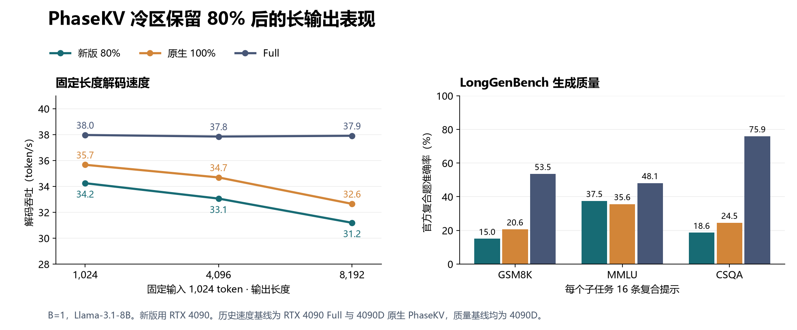

# PhaseKV 80% 复测 · 2026-11-02

Llama-3.1-8B-Instruct，FP16，单张 RTX 4090，B=1。归档校验通过。正式记录 1,126 条全部成功，无漏项、重复、OOM 或错误。逐条结果与冻结清单的样本 ID、输入哈希及重复号一致。模型配置为 prompt 保留 70%、热窗口 128、冷区每组 16 留 13。

## 固定长度解码速度

单位为 token/s。每个提示取 3 次计时中位数，每个形状再取 3 个提示的中位数。百分比先按相同提示求比值，再取中位数。Full+FA2 和 80% 分属两张 RTX 4090，原生 PhaseKV 100% 来自 RTX 4090D。

| 输入 + 输出 | 新版 80% | 原生 100%（4090D） | Full+FA2（4090） | 相对原生 100% | 相对 Full+FA2 |
|---|---:|---:|---:|---:|---:|
| 4096+256 | 34.70 | 36.08 | 37.90 | -3.85% | -8.45% |
| 8192+256 | 34.83 | 35.90 | 37.62 | -3.01% | -7.41% |
| 8192+2048 | 34.11 | 35.45 | 38.05 | -3.93% | -10.38% |
| 1024+1024 | 34.24 | 35.66 | 37.97 | -3.99% | -9.79% |
| 1024+4096 | 33.05 | 34.69 | 37.85 | -4.69% | -12.64% |
| 1024+8192 | 31.18 | 32.65 | 37.91 | -4.14% | -17.44% |

此前 RTX 4090 上的旧版 Triton 在同组三个提示上为 35.50 token/s，本轮为 34.83（配对 -1.91%）。优化版 100% 只测过第一个 8192+256 提示。该提示 100% 为 35.12，80% 为 34.84 token/s（-0.80%）。两次物理卡不同，计时入口及重复数也不同。

1024+8192 的首段与末段各约 128 步。跨 9 条记录取中位数，80% 为 28.32 → 36.86 ms/步，原生 100% 为 27.63 → 35.19，4090 Full+FA2 为 26.35 → 26.34。

## 质量

三列均使用相同输入。分数范围 0–100，越高越好。LongBench 混合 QA F1、ROUGE 和代码相似度，表中总体是这批样本的平均任务分。RULER 使用官方字符串匹配，LongGenBench 使用官方复合题准确率。质量基线均来自历史 4090D 实验。

| 基准或任务 | 样本数 | 本轮触发冷却 | 新版 80% | 原生 100% | Full |
|---|---:|---:|---:|---:|---:|
| longbench | 640 | 144 | 44.37 | 44.34 | 44.45 |
| 　2wikimqa | 64 | 0 | 56.67 | 56.67 | 56.67 |
| 　gov_report | 64 | 64 | 31.97 | 31.94 | 33.64 |
| 　hotpotqa | 64 | 0 | 53.99 | 53.98 | 53.79 |
| 　lcc | 64 | 0 | 68.16 | 68.16 | 70.31 |
| 　multi_news | 64 | 64 | 25.08 | 25.00 | 25.68 |
| 　multifieldqa_en | 64 | 0 | 53.60 | 53.98 | 53.53 |
| 　narrativeqa | 64 | 0 | 20.56 | 20.17 | 20.08 |
| 　qasper | 64 | 0 | 53.07 | 53.07 | 50.83 |
| 　qmsum | 64 | 16 | 23.37 | 23.09 | 22.84 |
| 　repobench-p | 64 | 0 | 57.25 | 57.33 | 57.16 |
| ruler | 384 | 0 | 96.77 | 96.84 | 96.81 |
| 　cwe | 96 | 0 | 88.65 | 88.65 | 88.54 |
| 　niah_multikey_1 | 96 | 0 | 100.00 | 100.00 | 100.00 |
| 　niah_multivalue | 96 | 0 | 98.44 | 98.70 | 98.70 |
| 　vt | 96 | 0 | 100.00 | 100.00 | 100.00 |
| longgenbench | 48 | 48 | 23.70 | 26.93 | 59.20 |
| 　csqa | 16 | 16 | 18.59 | 24.53 | 75.94 |
| 　gsm8k | 16 | 16 | 15.00 | 20.62 | 53.54 |
| 　mmlu | 16 | 16 | 37.50 | 35.62 | 48.12 |

## 冷却与长输出诊断

| 本轮实际输出分组 | 样本数 | 本轮触发冷却 | 新版 80% | 原生 100% | Full |
|---|---:|---:|---:|---:|---:|
| longbench 未冷却 | 496 | 0 | 49.11 | 49.09 | 48.97 |
| longbench 已冷却 | 144 | 144 | 28.04 | 27.97 | 28.90 |
| ruler 未冷却 | 384 | 0 | 96.77 | 96.84 | 96.81 |
| longgenbench 已冷却 | 48 | 48 | 23.70 | 26.93 | 59.20 |

LongGenBench 再按题号与标准答案对齐，缺答计错。下表均为逐样本百分比取平均，每格按新版 80% / 原生 100% / Full 排列。

| 子任务 | 按题号准确率 | 最后三分之一按题号准确率 | 可解析答案覆盖率 |
|---|---|---|---|
| gsm8k | 31.88 / 30.00 / 64.79 | 31.25 / 30.62 / 68.12 | 64.17 / 62.92 / 95.00 |
| mmlu | 37.50 / 34.58 / 47.08 | 31.88 / 28.75 / 43.12 | 74.38 / 73.54 / 80.83 |
| csqa | 19.69 / 24.53 / 75.94 | 14.29 / 20.54 / 75.00 | 49.06 / 55.62 / 100.00 |

实际冷却 192/1072 条质量样本。未冷却的 880 条中，823 条与原生 100% 的输出 token 逐个相同。上述分组按本轮生成结果确定。优化版 100% 缺少全量质量对照，原生 100% 与本轮同时存在实现及设备差异。
