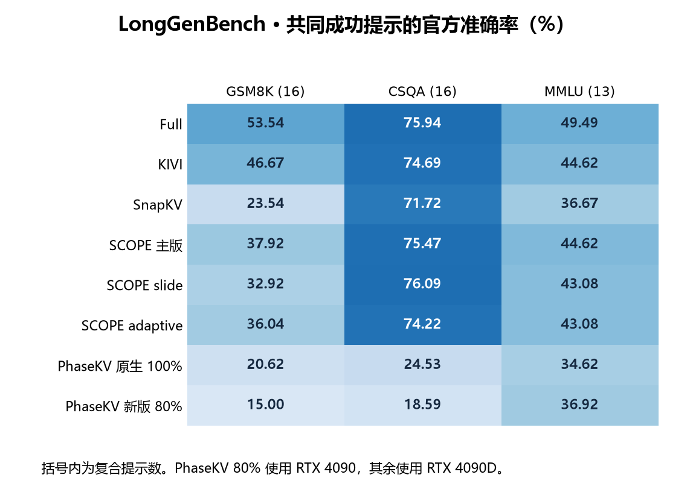

# LongGenBench 三个子任务的方法比较

Llama-3.1-8B-Instruct，FP16，batch=1，贪心生成，最多输出 4,096 token。每个子任务有 16 条复合提示，每条 GSM8K、CSQA、MMLU 提示分别含 30、40、30 道小题。新版 PhaseKV 80% 来自 RTX 4090 复测，其余配置来自同轮 RTX 4090D 原生基准。所有提示 ID 和输入哈希已对齐。

## 实验参数

共同环境为 PyTorch 2.5.1+cu121、CUDA 12.1、Transformers 4.46.3、FlashAttention 2.7.4.post1、Triton 3.1.0。三个任务均使用贪心解码，遇到模型的停止 token 提前结束。下表已与各方法成功样本的 `effective_options` 核对。

| 方法 | Prompt KV 设置 | 生成 KV 设置 |
|---|---|---|
| Full | 保留全部 FP16 KV | 逐步追加全部 FP16 KV，使用 Llama FlashAttention 2 |
| KIVI | 保留全部 prompt 位置。K、V 的量化部分均为 4-bit，量化分组 32，其余部分保留 FP16。48 条提示的预填充缓存逻辑长度均等于输入长度 | `residual_length=128`，K 的残差攒满一组 128 个位置后量化，V 保留最近 128 个位置的 FP16 残差。`use_flash=true` |
| SnapKV | 最多 2,048 个位置，观察窗口 32，最大池化核 7 | 逐步追加生成 KV |
| SCOPE 主版 | 最多 2,048 个位置，观察窗口 8，最大池化核 7 | `discontinuous`，解码窗口 512，近期窗口 256，`delta=15` |
| SCOPE slide | 同 SCOPE 主版 | `slide`，解码窗口 512，近期窗口 256，配置记录 `delta=15` |
| SCOPE adaptive | 同 SCOPE 主版 | `adaptive`，解码窗口 512，近期窗口 256，`delta=15` |
| PhaseKV 原生 100% | 保留 70%，观察窗口 32，最大池化核 7，`sink_tokens=0`，4-bit，量化分组参数 32 | 最近 128 个位置保留 FP16，每累积 16 个旧位置冷却一次，16 个全留，冷区 4-bit |
| PhaseKV 新版 80% | 同 PhaseKV 原生 100% | 热窗口 128，每 16 个旧位置按各 KV 头的 V 向量范数选 13 个，冷区 4-bit。配置保留率 0.80，每个冷块实际保留 81.25%，打包 K 使用通道连续布局 |

三个 SCOPE 版本的调度参数由输出上限计算，`delta = (4096 − 256) // (512 − 256) = 15`。两版 PhaseKV 均启用融合量化、工作区复用、冷区分页、4-bit 专用注意力和环形热缓存，`page_slots=32`、`cold_group=8`、`gqa_reuse=false`。

| 子任务 | 实际输入长度（token） | PhaseKV 原生预填充后保留位置 | SnapKV 预填充后保留位置 |
|---|---:|---:|---:|
| GSM8K | 2,510–3,061 | 1,757–2,143 | 2,048 |
| CSQA | 2,111–2,308 | 1,478–1,616 | 2,048 |
| MMLU | 1,709–13,075 | 1,196–9,152 | 1,709–2,048 |

保留位置取自每条记录的 `prefill_trace`。两种预算会随任务产生不同的实际缓存长度。SCOPE 成功样本的预填充后保留范围与表中 SnapKV 一列一致。

## 官方准确率（%）

前三列在该方法成功生成的提示上取平均，OOM 单列。最右列限定为所有方法都成功的 13 条 MMLU 提示。GSM8K 和 CSQA 均为相同的 16 条。

| 方法 | GSM8K | CSQA | MMLU | 成功 / 48 | MMLU · 共同 13 条 |
|---|---:|---:|---:|---:|---:|
| Full | 53.54 | 75.94 | 48.12 | 48/48 | 49.49 |
| KIVI | 46.67 | 74.69 | 46.04 | 48/48 | 44.62 |
| SnapKV | 23.54 | 71.72 | 33.12 | 48/48 | 36.67 |
| SCOPE 主版 | 37.92 | 75.47 | 44.62 | 45/48 | 44.62 |
| SCOPE slide | 32.92 | 76.09 | 43.08 | 45/48 | 43.08 |
| SCOPE adaptive | 36.04 | 74.22 | 43.08 | 45/48 | 43.08 |
| PhaseKV 原生 100% | 20.62 | 24.53 | 35.62 | 48/48 | 34.62 |
| PhaseKV 新版 80% | 15.00 | 18.59 | 37.50 | 48/48 | 36.92 |

SCOPE 主版使用 discontinuous 策略。主版、slide、adaptive 在同样 3 条 MMLU 提示上显存不足。每种 SCOPE 若把这 3 条按 0 分计入 16 条系统成绩，MMLU 分别为 36.25%、35.00%、35.00%。

## 按题号核对答案

下表只用共同成功的提示（GSM8K 16、CSQA 16、MMLU 13）。每格为“按题号准确率 / 可解析答案覆盖率”，均为百分比。官方评分按抽取顺序比对，漏掉中间答案后可能错位。按题号评分给缺答记错，覆盖率统计能解析出预期题号及答案的小题比例。

| 方法 | GSM8K | CSQA | MMLU |
|---|---:|---:|---:|
| Full | 64.79 / 95.00 | 75.94 / 100.00 | 49.49 / 84.10 |
| KIVI | 61.46 / 88.33 | 74.69 / 100.00 | 40.26 / 67.18 |
| SnapKV | 35.42 / 67.08 | 73.75 / 99.84 | 37.69 / 75.38 |
| SCOPE 主版 | 53.54 / 87.08 | 75.47 / 100.00 | 43.33 / 72.82 |
| SCOPE slide | 50.21 / 83.54 | 76.09 / 100.00 | 43.08 / 75.13 |
| SCOPE adaptive | 50.21 / 81.67 | 74.22 / 100.00 | 42.05 / 72.56 |
| PhaseKV 原生 100% | 30.00 / 62.92 | 24.53 / 55.62 | 34.62 / 67.44 |
| PhaseKV 新版 80% | 31.88 / 64.17 | 19.69 / 49.06 | 36.92 / 70.51 |

GSM8K 上，KIVI 的官方准确率在压缩方法中最高。PhaseKV 新版 80% 的官方分低于原生 100%，按题号核对却从 30.00% 升至 31.88%，这两种评分给出的变化方向不同。

CSQA 上，KIVI、SnapKV 和三个 SCOPE 版本都超过 71%，SCOPE slide 在总共 640 道小题中比 Full 多答对 1 道。PhaseKV 原生 100% 和新版 80% 的可解析覆盖率分别为 55.62% 和 49.06%，其余方法均在 99.84% 以上。按题号核对后，PhaseKV 与 Full 的差距仍然很大。

MMLU 上，KIVI 和 SCOPE 主版在共同 13 条提示上均为 44.62%，Full 为 49.49%。PhaseKV 80% 在这组提示上比原生 100% 高 2.30 个百分点。两轮同时存在实现和运行设备差异。

原始数据见[原生测试逐条记录](../不同算法的不同数据集测试/native_llama_20261029/records.jsonl)和[80% 复测结果包](PhaseKV_4090_keep80_results.zip)。每个子任务只有 16 条复合提示，小幅分差按本批观测值解读。
