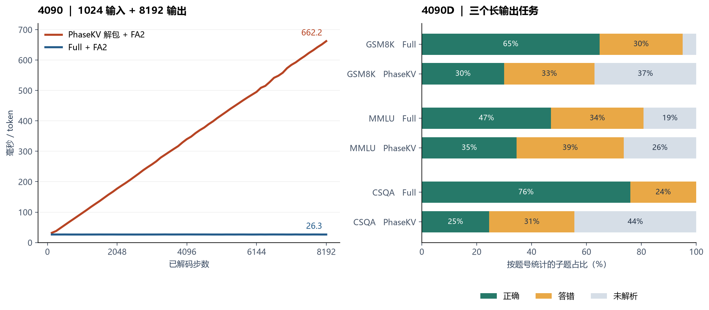
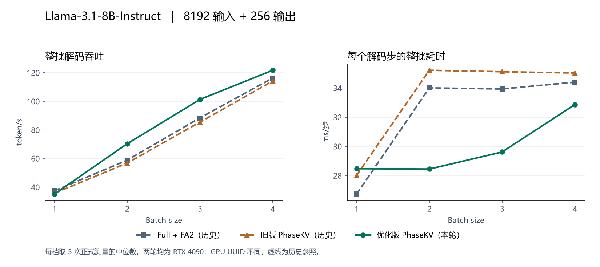

# PhaseKV 与 Full 的解码消融实验

**2026-11-01 下载核验：本轮未跑完。** 原计划内有 4,504 条，已写入 126 条独立记录，其中 120 条成功、6 条显存不足（OOM）、0 条其他错误。还有 4,378 条未写入。两组 FlashAttention 2（FA2）的性能测试已经全部成功，可以直接比较。两组 Triton 的性能测试尚缺 90 条，三个质量数据集尚无正式记录。

## 为什么做这三个消融

上一轮比较 Full 和 PhaseKV 时，常驻 KV 缓存与解码注意力内核同时变了。要解释速度差异，本轮用 **Full FP16 缓存 + FA2**（`full_fa2`）作基线，再加入下面三个配置，构成两种缓存 × 两种解码后端。四组都用同一张 RTX 4090、同一套 Llama-3.1-8B-Instruct 权重、FP16、batch=1、相同的冻结输入和贪心解码。

| 新增配置 | 怎么做 | 与谁比，回答什么问题 |
|---|---|---|
| ① PhaseKV 解包 + FA2（`phasekv_fa2`） | 常驻压缩 KV。每个解码步逐层把保留的 KV 还原为临时 FP16，再调用与基线相同的 FA2。解包、复制和缓存更新都计时。 | 与 `full_fa2` 比。固定注意力内核后，少读历史 KV 的收益能否抵消解包和复制成本？ |
| ② Full FP16 + Triton（`full_triton`） | 保留 Full FP16 缓存，用共用分段 Triton 内核的 FP16 分支计算解码注意力。 | 与 `full_fa2` 比。固定 Full 缓存，单独更换解码后端会造成多大速度差异？这组也为③提供同框架的 Full 对照。 |
| ③ PhaseKV 融合 + Triton（`phasekv_triton`） | 直接读取打包的 KV，在分段注意力计算中反量化，省去逐层写出完整临时 FP16 KV 的步骤。 | 与 `full_triton` 比，观察同一 Triton 框架下压缩缓存的净效果；与 `phasekv_fa2` 比，观察同一压缩策略下融合路径相对显式解包路径的净收益。 |

三个新增配置支持四个配对比较。③的两个后端在舍入精度和内核实现上也有差别，因此两者耗时之差不能直接当作纯解包时间。以上控制针对解码阶段。预填充时，PhaseKV 还要执行观察、选择和打包，比较首 token 延迟时要计入这些工作。

## 哪些结果已经落盘

| 正式性能测试 | 计划 | 成功 | OOM | 待跑 |
|---|---:|---:|---:|---:|
| Full + FA2 | 54 | 54 | 0 | 0 |
| PhaseKV 解包 + FA2 | 54 | 54 | 0 | 0 |
| Full + Triton | 54 | 3 | 6 | 45 |
| PhaseKV 融合 + Triton | 54 | 9 | 0 | 45 |
| **合计** | **216** | **120** | **6** | **90** |

质量测试待跑 **4,288** 条，其中 LongBench 2,560 条、RULER 1,536 条、LongGenBench 192 条。当前无法据此判断四组的准确度差异。另有 108 条按历史 OOM 条件在开跑前统一排除，覆盖 `16384+256`、`16384+4096`、`32000+256` 三种长度组合，均未计入本轮 4,504 条。

首轮 `8192+256` 的 36 个测试位置都有记录，30 条成功、6 条 OOM。6 条全部属于 Full + Triton，集中在后两个提示各三次重复的显存诊断预热阶段，没有对应的正式解码速度。首轮汇总是上述 126 条的子集。主日志最后显示调度器已切到 Full + Triton 的后续性能任务，该任务日志为空，没有新增正式结果。

## 现有数据已经能回答什么

两组 FA2 在全部六种长度下都有完整配对。对每个相同提示先取三次成功重复的解码速度中位数，计算 PhaseKV 解包 + FA2 除以 Full + FA2 的比值，再取三个提示的比值中位数。小于 1 表示 PhaseKV 解包路径更慢。

| 输入 + 输出 token 数 | PhaseKV 解包 + FA2 / Full + FA2 |
|---|---:|
| 1024 + 1024 | 0.423× |
| 1024 + 4096 | 0.145× |
| 1024 + 8192 | 0.077× |
| 4096 + 256 | 0.762× |
| 8192 + 256 | 0.759× |
| 8192 + 2048 | 0.252× |

在这张卡上，当前显式解包实现接入同一 FA2 后，六种长度下均慢于 Full。输入固定为 1,024 token 时，输出越长，实测相对吞吐越低。在 `8192+256` 上，PhaseKV 融合路径相对 PhaseKV 解包路径为 **1.249×**（3 个配对提示）。同一 Triton 框架下 PhaseKV 相对 Full 为 **0.906×**，但只有 **1 个**提示双方都成功，不能代表全部三个提示。

## 是否续跑

若只需回答“相同 FA2 下，当前 PhaseKV 解包实现是否更快”，现有性能数据已够。若要交付完整消融和数据集质量比较，建议续跑，先补两组 Triton 各 45 条性能记录，再跑质量测试。默认续跑会保留已写入的成功及 OOM 记录，6 条 OOM 不在 4,378 条待跑记录内。

原输出目录是 `/root/data/phasekv-results/rtx4090_b1_common_v1`。原启动器把物理 GPU UUID、环境、代码和样本分配纳入协议校验。若重新开机分配到另一张 4090，即使型号相同，原目录也会被拒绝续写。原卡 UUID 为 `GPU-d80cb93c-5c90-3f91-5de8-949c969abc03`，可用 `nvidia-smi --query-gpu=uuid --format=csv,noheader` 核对。若换卡且论文要求同一张物理卡，应使用独立目录，在新卡上重测需要同卡配对的配置。

核验依据为同目录的 `rtx4090_partial_results.tar.gz`。已验证 gzip 完整性，按冻结样本重建计划，并逐条核对 `lanes/0/records/` 中的样本、方法、重复号、输入哈希和协议哈希。GPU 数值检查已通过；预热、性能分析轨迹和首轮汇总均未重复计数。

## 解码每一步的时间花在哪里



左图使用 4090 正式计时中约 128 步的区间均值，仅绘制至少 100 步的区间。右图使用上一轮 4090D 在相同冻结输入上的质量输出。两个面板属于不同轮次。

### 先看同一个提示上的四条路径

取本轮唯一有四组完整配对、且四组都有 GPU 轨迹的提示 `performance/8192+256/0`。单位均为毫秒/解码 token。第一列耗时是正式生成的 255 个解码步均值，再取三次重复的中位数；首 token 属于预填充。其余列来自独立采样的第 144～159 步，将 CUDA 事件时长求和后除以 16。正式记录只保存分块时间，不能恢复每个 token 的精确端到端延迟。

| 方法 | 正式端到端 | GPU 事件合计 | 模型矩阵向量乘 GEMV | 注意力内核（含归并） | 显式解包内核 | 其余 GPU 事件 |
|---|---:|---:|---:|---:|---:|---:|
| Full + FA2 | 26.58 | 21.48 | 16.29 | 0.97 | 0 | 4.22 |
| PhaseKV 解包 + FA2 | 35.01 | 22.14 | 16.22 | 0.76 | 3.34 | 1.82 |
| Full + Triton | 26.62 | 23.96 | 16.26 | 3.50 | 0 | 4.20 |
| PhaseKV 融合 + Triton | 29.37 | 22.34 | 16.38 | 4.42 | 0 | 1.54 |

**原生融合 PhaseKV。** 16 个采样步逐步按输出 argmax 划界，每步 GPU 事件合计 22.31～22.44 ms。模型矩阵向量乘占约 73%，是 batch=1 整个模型最大的耗时项，四种方法都要付这笔成本。PhaseKV 特有的优化机会主要在分段注意力主核（4.27 ms/步），归并仅 0.15 ms/步。在同一 Triton 框架下，Full 的主核为 3.24 ms/步；压缩后减少了 KV，却多出约 1.03 ms 主核时间。当前轨迹不能再区分其中多少用于读 KV、反量化或 softmax。第 144 步发生冷却，当步可识别的量化内核合计约 0.114 ms，其余 15 步没有这些量化事件。这是量化内核自身的时间，未覆盖所有缓存管理开销。

**显式解包接 FA2。** 注意力从 Full 的 0.97 降至 0.76 ms/步，但仅解包内核就要 3.34 ms/步，再加上逐层创建临时 FP16 缓冲、拷贝 hot KV、启动各段内核的成本。第 144 步调用 32 次解包内核；冷却新增一个段后，第 145～159 步每步调用 64 次。FA2 注意力核本身省下的约 0.21 ms 抵不过解包开销。GPU 事件与正式端到端来自不同的生成过程和时间窗，两者之差不能解读为实测 CPU 时间。这次没有硬件带宽计数或 CPU 分项计时。

### 长输出会把两种实现拉开

下表使用本轮完整的两组 FA2。对每个相同提示先取三次重复的中位数，再跨三个提示取中位数。“首段”为前 128 个解码步，“末段”为最后 127 个解码步。

| 输入 + 输出 | Full 全程 ms/步 | PhaseKV 解包全程 ms/步 | PhaseKV 解包首段 → 末段 ms/步 |
|---|---:|---:|---:|
| 1024 + 1024 | 26.34 | 62.18 | 31.73 → 95.20 |
| 1024 + 4096 | 26.42 | 181.69 | 31.78 → 338.83 |
| 1024 + 8192 | 26.38 | 343.58 | 31.79 → 662.19 |
| 4096 + 256 | 26.39 | 34.63 | 31.73 → 37.63 |
| 8192 + 256 | 26.58 | 35.19 | 32.04 → 38.11 |
| 8192 + 2048 | 26.28 | 104.26 | 31.92 → 180.18 |

在 `1024+8192` 中，Full 首段和末段均约 26.3 ms/步。PhaseKV 解包路径一条正式记录的冷段数从 0 增至 503。代码在每一层、每一步遍历 prompt 段和全部历史冷段，每段单独启动一次解包，再调用 FA2。按 32 层计算，有 503 个冷段时，若再解码一步，仅还原一个 prompt 段和这些冷段就需要 32 × 504 = 16,128 次内核启动。这个末端次数按实现推算；长输出后段没有单独的 GPU 轨迹，不能把 662 ms 全部归到启动或带宽。若继续优化这条路径，最值得先改的是按层批量解包，避免每个历史冷段各启动一次。即便合并启动，逐步重写 FP16 KV 的成本仍在。

原生融合路径不会为每个旧段逐个启动解包。本轮 4090 尚无其长输出正式记录；另查上一轮 4090D 的 `1024+8192`，原生 PhaseKV 首段/末段为 **27.63 → 35.19 ms/步**（9 条成功记录的中位数）。两轮的绝对时延应分别报告，不能把 662 ms 写成原生 PhaseKV 的速度。

## 为什么 LongGenBench 的三个子任务掉分

本轮四组消融没有质量输出。下文单独使用 `native_llama_20261029` 的 Full 和原生 PhaseKV，按提示 ID 和输入哈希配对，核查生成文本和 token ID，并用冻结参考答案重算官方分与按题号诊断分。48 个复合提示中每组两种方法都成功完成推理，无输入截断。每个任务 16 个复合提示，GSM8K/MMLU 每个提示各含 30 道子题，CSQA 含 40 道。一次生成的上限为 4,096 token。

| 任务 | 官方分 Full → PhaseKV | 按题号可解析子题 Full → PhaseKV | 双方均可解析的同一批子题上，Full → PhaseKV 答对数 | 触及输出上限的提示 Full → PhaseKV |
|---|---:|---:|---:|---:|
| GSM8K | 53.54 → 20.63 | 456 → 302 / 480 | 203 → 142 / 299 | 1 → 11 / 16 |
| MMLU | 48.13 → 35.63 | 388 → 353 / 480 | 194 → 160 / 323 | 6 → 6 / 16 |
| CSQA | 75.94 → 24.53 | 640 → 356 / 640 | 273 → 157 / 356 | 13 → 16 / 16 |

“可解析”要求在正确题号下出现评分器认可的答案格式。缺少这种格式可能是漏答、编号错位、写法不同或陷入循环。官方评分则按正则提取的答案出现顺序与参考答案对齐，漏掉中间一题可能使后续错位。因此同时检查原文和题号。

- **GSM8K 同时出现编号循环、格式漏认和算错。** 提示 12、15、32 都在首个答案处将 `Answer_9:` 重复 1,024 次，耗尽 4,096 token。提示 33 在第一个答案里反复解释同一段话。另有真实答错，例如提示 24 第一题，参考答案为 4，PhaseKV 写出 −1。按题号对齐后 Full 与 PhaseKV 为 64.79% 和 30.00%；保留原规则并额外接受 “answer is $数字” 后为 67.08% 和 32.71%。评分格式影响绝对值，二者差距仍大。
- **MMLU 主要表现为选项准确率下降，并有少数整份答偏。** 两种方法各有 6/16 触顶。即使只看双方均可解析的 323 道相同子题，正确数仍从 194 降到 160。提示 7 应回答第 6～35 题，PhaseKV 却从 `Answer_36` 一直编号到 162；提示 1 在第一道题反复解释神经解剖，未给出可识别的选项。按题号后为 47.08% 对 34.58%，分差仍是 12.50 个百分点。
- **CSQA 的最大损失来自答案没有按要求生成，同时伴有选错。** 4/16 个提示将 `Answer_6:` 原样重复 1,024 次，第 5 个重复 1,023 次，仅有空格等细微变化。还有一个完全不同的例子：提示 0 实际列出第 6～45 题的全部 40 个选项，但写成 `Answer: (A)` 一类格式，官方得零。按题号额外接受这一行格式，单份可恢复 25/40，全任务 PhaseKV 从 24.53% 升到 28.44%，Full 仍为 75.94%。即便双方均有严格可识别答案，PhaseKV 也少答对 116 道。Full 同样有 13/16 个提示触顶，却覆盖全部 640 道子题；仅凭触顶无法判断丢分。

### 能把原因定位到哪一环

逐条比较 Full 与 PhaseKV 的贪心输出 token ID，三项任务的首次分歧中位数分别是第 **5、12、5** 个 token；全部 48 个提示在第 **3～80** 个 token 内就已分歧。8 个严重编号循环的提示（GSM8K 3 个、CSQA 5 个）都在第 5 个 token 分叉，Full 开始写答案时 PhaseKV 再次写编号。生成 token 的热窗口为 128，凑齐额外 16 个才第一次转冷。因此这些循环的**起点**早于生成历史第一次转冷；后续转冷仍可能影响长序列。

优先怀疑的是解码一开始就使用的压缩 prompt。当前配置按末 32 个 query 的注意力逐层、逐 KV 头挑选并保留约 70% 的 prompt 位置，剩余位置的 K/V 以 4 bit 存储。复合提示把格式示例放在前面，后续排着 30～40 道不同问题；末尾的注意力未必代表生成首题及后续各题所需的信息。CSQA 提示 3 中，Full 保留 2,268 个位置，PhaseKV 保留 1,588 个，从第 5 个输出 token 就开始循环。现有记录没有保存逐题保留位置或首个分歧步的 logits，无法判定具体哪一道题的信息被删掉，也不能单凭输出区分 prompt 裁剪、4-bit 表示及解码内核数值差异。编号循环本身足以解释这些样本为什么得零。

若以后只做最小验证，优先用上述循环样本，固定相同前缀并比较第 5 个 token 的候选 logits，在相同解码后端分别控制 prompt 保留率（100% / 70%）与精度（FP16 / 4 bit）。这样能在生成缓存转冷前区分裁剪与量化的影响；这几组对照本次均未运行。

性能证据取自下载包内的 `lanes/0/records/`、`lanes/0/decode_profiles/*.trace.json`，以及 `official_llama/ablation_kernels.py` 的 `materialize`。质量证据取自上一轮的 `records.jsonl`、冻结的 `samples.jsonl.gz`、`official_llama/benchmark_metrics.py` 和 `official_llama/native_runtime.py`。补充解析只用于定位丢分原因，保留原官方指标。

## 2026-11-01 本地分段注意力主核优化

在项目的 PhaseKV P5 配置上新增可选项 `channel_contiguous_k`。将 4-bit K 的量化码、scale 和 min 直接写成相邻通道连续的布局，主核按固定步幅寻址；prompt 与 cold 继续各自沿 token 轴分组量化，保持原归约顺序。已检查旧布局及缓存重排后的通用读取路径。正式 4090 消融的冻结代码和原始结果独立保存。本次新代码由项目根目录的 Qwen2 和 Llama 适配器调用。

**主核单测。** 本机 RTX 3070 Ti Laptop 8 GB，PyTorch 2.5.1+cu121、Triton 3.1。4-bit prompt/cold、保留 70% prompt、hot=136。每个合成输入固定 Q 和 KV，预热后用 CUDA Graph 重放同一主核 64 次，旧版和新版交替测量 8 轮，取单次 GPU 时长中位数。下表仅含分段注意力第一次内核调用，不含归并、投影、解码循环。两种头数均在同一张笔记本 GPU 上测试。

| 输入长度 / 冷段数 | Qwen 头数 12Q/2KV，旧 → 新（µs） | Llama 头数 32Q/8KV，旧 → 新（µs） |
|---|---:|---:|
| 1,024 / 0 | 57.00 → 48.46 | 79.62 → 73.98 |
| 8,192 / 1 | 195.92 → 180.84 | 558.46 → 462.26 |
| 8,192 / 32 | 222.65 → 192.04 | 607.98 → 502.12 |
| 1,024 / 128 | 120.83 → 96.56 | 270.16 → 238.48 |

8 个配置的主核耗时均下降，Qwen 头数下降 7.7%～20.1%，Llama 头数下降 7.1%～17.4%。8 组新旧缓存的量化码和元数据逐项相同，归并后 FP16 注意力输出最大绝对差均为 0。早期尝试过将每个线程块从 4 个 warp 减到 2 个，虽然计时更快，但真实 Qwen 在第 3 个解码步就改变了贪心输出，所以交付版本保留原线程分组。

**真实 Qwen2-1.5B-Instruct。** batch=1，模型 BF16，压缩注意力输入 FP16。使用固定文本构造规定长度的输入，每组两版共享同一次预填充，再独立建缓存、贪心生成。超过 2,048 的输入分块预填充，仅保留末 32 个 query 的注意力分数用于筛选。每版先预热一轮，之后交替先后顺序。计时覆盖实际模型解码、KV 更新和取下一个 token，排除预填充及初始缓存打包。下表是按整轮 ms/token 取中位数后换算的吞吐；总输出数包含不计入解码计时的首 token。

| 输入 / 总输出 | 计时解码步 | 每版计时轮数 | 旧 → 新（ms/token） | 旧 → 新（token/s） | 吞吐变化 |
|---|---:|---:|---:|---:|---:|
| 1,024 / 161 | 160 | 4 | 24.91 → 24.38 | 40.14 → 41.02 | +2.2% |
| 8,192 / 161 | 160 | 4 | 24.12 → 25.36 | 41.46 → 39.43 | −4.9% |
| 8,192 / 256 | 255 | 6 | 25.50 → 25.33 | 39.22 → 39.49 | +0.7% |

三组所有重复的生成 token 均与对应旧版一致，末步 logits 最大绝对差均为 0。`8192+256` 的 6 轮中新版有 5 轮更快，而 `8192+161` 的 4 轮全部更慢。主核变快可以复现，整模型尚未表现出稳定加速。因此保持显式启用；本轮未测试三个质量数据集或 4090 上的实际 Llama-8B 吞吐。

逐轮时间、打包时间、输出 token 摘要及配置见 [分段主核本地验证.json](分段主核本地验证.json)。本机复现可在项目根目录的 PowerShell 中执行下列命令，输出另存为复测文件。所用 Qwen 权重版本为 `ba1cf1846d7df0a0591d6c00649f57e798519da8`，safetensors 已校验 SHA-256。

```powershell
$env:PYTHONPATH = (Resolve-Path '.cache/local-sm86-torch').Path
.\.venv\Scripts\python.exe scripts/bench_phasekv_main_kernel.py --model .cache/Qwen2-1.5B-Instruct --prompt 8192 --steps 255 --repeats 6 --out .cache/segmented-8k-retest.json
```

## Full 缓存下的矩阵向量乘耗时

使用本轮 RTX 4090 上 Llama-3.1-8B-Instruct 的原始 CUDA 轨迹，FP16、batch=1、提示 `performance/8192+256/0`。第 144～159 个解码步各有 32 层 × 7 个投影 + 1 个词表投影，共 225 次线性层调用。每个后端均核对了 3,600 个 `aten::linear`，按嵌套的 `aten::mm` 关联到 GPU GEMV 内核，再按模型前向顺序和 CUDA 网格尺寸识别投影。下表为 16 步平均的 **GPU 毫秒/token**，已经加总所有层。

| 投影 | Full + FA2 | Full + Triton |
|---|---:|---:|
| Q | 1.210 | 1.209 |
| K | 0.360 | 0.361 |
| V | 0.363 | 0.362 |
| O | 1.251 | 1.234 |
| **注意力投影合计** | **3.184** | **3.166** |
| MLP gate | 4.016 | 4.000 |
| MLP up | 3.990 | 3.989 |
| MLP down | 4.004 | 4.006 |
| **MLP 投影合计** | **12.010** | **11.995** |
| 词表投影 lm_head | 1.098 | 1.098 |
| **全部线性层合计** | **16.293** | **16.259** |

Full + FA2 的 16 个单步线性层总耗时范围为 16.266～16.310 ms。MLP 三个投影占全部线性层时间的 73.72%；再计入 SiLU 激活与门控逐元素乘法（0.035 和 0.030 ms/token），MLP 的 GPU 计算合计 12.076 ms/token。注意力投影和 MLP 投影合计 15.195 ms/token，词表投影另计。该窗口所有 GPU 内核合计 21.482 ms/token，线性层占 75.8%。权重带宽、CPU 提交和模型端到端延迟均不由这张分项表直接测量。

## 同一提示上 Full 与原生 PhaseKV 的吞吐差

单卡 RTX 4090，Llama-3.1-8B-Instruct，FP16，batch=1，`performance/8192+256/0`。Full 使用 FA2；PhaseKV 使用该轮冻结的融合 Triton 实现。以下正式计时各取三次重复的中位数。首 token 在预填充阶段生成。

| 正式计时指标 | Full + FA2 | 原生 PhaseKV | PhaseKV − Full |
|---|---:|---:|---:|
| 到首 token（含预填充与适用的压缩步骤），秒 | 0.9424 | 1.0175 | +0.0751 |
| 后续 255 个 token 解码，秒 | 6.7767 | 7.4888 | +0.7121 |
| 解码，ms/token | 26.575 | 29.368 | +2.793 |
| 解码吞吐，token/s | 37.629 | 34.051 | −3.578（−9.51%） |

下面的 GPU 分项取同一提示的独立 profiler 运行，第 144～159 个解码步。单位为 ms/token，已加总全部 32 层。按设备事件关联到对应的 `aten` 运算，逐层区分 RoPE 中的拼接和 KV 更新中的拼接；各行互斥，其他设备工作包括剩余内核和设备复制事件。

| 解码分项 | Full + FA2 | 原生 PhaseKV | PhaseKV − Full |
|---|---:|---:|---:|
| Q/K/V/O 线性投影 | 3.184 | 3.204 | +0.020 |
| 对 Q/K 应用 RoPE | 0.544 | 0.525 | −0.019 |
| 追加当前 token 的 K/V（Full 动态拼接；PhaseKV 写热缓存） | 2.755 | 0.108 | −2.647 |
| 注意力（含归并） | 0.975 | 4.418 | +3.443 |
| 冷段量化内核（摊到 16 步） | 0 | 0.007 | +0.007 |
| MLP 三个线性投影 | 12.010 | 12.081 | +0.071 |
| MLP 激活与门控乘法 | 0.065 | 0.065 | <0.001 |
| 输出词表投影 | 1.098 | 1.098 | <0.001 |
| 其他设备工作 | 0.850 | 0.832 | −0.018 |
| **GPU 设备事件合计** | **21.482** | **22.337** | **+0.855** |

最大的正、负差分别是注意力多花 3.443 ms 和追加 KV 省 2.647 ms，两项合计 PhaseKV 多花 0.796 ms。正式全程每步多花 2.793 ms，而独立采样窗口内设备事件合计多花 0.855 ms。两个差值相减约 1.937 ms，覆盖范围和运行不同，无法据此给 Python 处理、发射间隙或同步分别计时。在该形状另两个提示上，三次重复中位数的吞吐分别下降 4.96% 和 4.21%；只有提示 0 有上述逐阶段轨迹。

## 固定 RTX 4090 的带宽与算力，估计大 batch 的吞吐交点

**当前动态 Full 的乐观交点是 batch=2，实测临界 batch 仍未知。** 分析对象是上述 `performance/8192+256/0`，使用冻结的原生融合 PhaseKV，以正式记录中的 2.793 ms/步劣势为起点。比较同一个 batch，每步各序列各生成 1 个 token，吞吐为 batch 除以整批步时。假定序列等长、无共享前缀，采用真正的批处理；串行运行多次独立请求不满足这个前提。单位 GB 为十进制。

### 一条序列每步有多少 KV 要处理

Full 每个上下文位置占 2（K/V）× 32 层 × 8 个 KV 头 × 128 维 × 2 字节 = **131,072 字节**。第 s 个解码步（s=1…255）注意力可见 8192+s 个位置。全程平均逻辑 KV 载荷 F=**1.090519 GB/序列/步**。

PhaseKV 保留 5,734 个 prompt 位置；记录给出 prompt 的码和元数据共 234,971,136 字节。注意力发生在当步冷却之前。第 s 步已转冷的位置数为 16 × max(0, floor((s−1−128)/16))，其余生成位置尚在 hot。每个冷位置的 4-bit 码占 32,768 字节，K16/V32 分组的 FP16 scale/min 共占 12,288 字节；每个热位置仍占 131,072 字节。255 步平均为 **0.249368 GB/序列/步**（记为 P），含有效元数据，剔除空页、空热槽和空闲工作区。

| 理想逻辑流量，GB/序列/步 | Full 动态缓存 | PhaseKV | 可节省 |
|---|---:|---:|---:|
| 注意力各读一次有效 KV | 1.091 | 0.249 | 0.841 |
| 因追加而整段读写历史 KV | 约 2.181 | 0 | 约 2.181 |
| 两项合计 | 约 3.272 | 约 0.249 | **约 3.022** |

此处统计历史 KV 的主要流量。PhaseKV 写入当前 token、周期性冷却、描述符和部分结果的读写另计。实际显存流量还受 L2 命中、GQA 多个 Q 头的读取复用和访存方式影响；这些字节数来自算法与缓存记录，未读取 DRAM 硬件计数器。

### 用实测差距校准门槛

以 800 GB/s（0.800 GB/ms）作为新增流量处于带宽受限区间时的有效带宽情景。此值参考原 GPU 采样窗口：Full 拼接 K/V 的逻辑读写约 2.187 GB/步，耗时 2.755 ms，等效约 794 GB/s。该值只代表复制的逻辑字节率。4090 的标称峰值为 1,008 GB/s，不能直接当成两个注意力内核的实测带宽。[NVIDIA Ada 架构白皮书，附录 A](https://images.nvidia.com/aem-dam/Solutions/geforce/ada/nvidia-ada-gpu-architecture.pdf)

令 c 表示多加一条序列时，PhaseKV 相对 Full 超过理想字节模型的净增耗时（ms/整批步/新增序列）。它容纳未隐藏的反量化、额外流量、两种内核有效带宽差异和调度差异。两种方法共有的投影/MLP 在做差时约去。将每增加一条序列的边际成本近似为常数，则：

    整批步时差 ΔT(B) ≈ 2.793 − (B−1) × (3.022 / 0.800 − c)  ms

PhaseKV 吞吐更高要求 ΔT(B)<0。等价地，相对 batch=1 还要省出超过 **2.234 GB/整批步** 的净等效流量；每份额外的未隐藏成本 c 还要消耗 0.800×c GB 的收益。在 c=0 的情景，总逻辑节省超过 **5.256 GB/整批步** 即过线，对应连续交点 B≈1.74，首个整数 batch 为 2。

| batch | 相比 B=1 新增的名义节省（GB/整批步） | 为使 PhaseKV 胜出，c 必须低于（ms/新增序列） |
|---:|---:|---:|
| 2 | 3.022 | 0.985 |
| 4 | 9.067 | 2.847 |
| 8 | 21.155 | 3.379 |

若 c=2 ms，首个过线 batch 为 3；若 c=3 ms，则为 5；若 c≥3.778 ms，在线性模型下增加 batch 不会反超。提高 batch 可以让一批请求共同分摊模型权重读取，但两个方法都受益。是否反超取决于各自的 KV 路径随 batch 增加的实际耗时，单个 batch=1 数据点无法识别这个斜率。在 batch=1 的只读 KV 估计中，PhaseKV 相对 Full 省下的 0.841 GB按 800 GB/s 只值 1.051 ms；实测 PhaseKV 的注意力核反而比 FA2 多花 3.443 ms，说明不能假设新增序列的 c 为零。

若把 Full 改成预分配 KV 并原地追加，主要逻辑节省由 3.022 降为 **0.841 GB/序列/步**。举例，若预分配恰好去掉实测的 2.755 ms 拼接开销，其余成本不变，则 B=1 差距约为 5.548 ms；在同样的 800 GB/s、c=0 情景下，连续交点约 6.28，首个整数 batch 为 **7**。这是未运行的新基线情景，不能当作已测性能或显存容量承诺。

冻结的正式注意力适配器只支持 batch=1。要验证模型，需用真正的批处理实现，在同卡同长度下测两种方法的整批步时 T(1)、T(2)，再以 B=4 检验斜率。若有硬件计数器，同时读取 DRAM 读写字节，即可区分实际流量节省与未隐藏的计算开销。

## 下一轮单卡诊断：同窗计时与逐 batch 增量

**建议使用 1 张 24 GB RTX 4090。** 已有 8K、B=1 的 9 条成功性能记录中，Full / 原生 PhaseKV 的峰值 allocated 分别为 16.98 / 16.88 GiB，reserved 为 17.42 / 17.53 GiB。上次设备可见容量约 23.52 GiB。Full 每多一条 8K 序列，末步的常驻 KV 约增加 1.03 GiB。B=2 有较大余量，B=3、4 逐档实测；激活、分配器和临时区会改变峰值，B=4、8 均无容量保证。两种方法依次独占 GPU。

**旧数据还能解释多少。** 在两份历史 trace 内，各自从第一个设备事件的开始对齐到最后一个设备事件的结束，取第 144～159 步的平均值。设备区间用并集，避免并行事件重复计时。完整数据见同目录的《历史1.94ms复核.json》。

| 旧轨迹，ms/步 | Full | PhaseKV | PhaseKV − Full |
|---|---:|---:|---:|
| 设备事件占用 | 21.482 | 22.337 | +0.855 |
| 上述边界内没有设备事件的时间 | 26.411 | 27.351 | +0.940 |
| 首末设备事件之间的总跨度 | 47.893 | 49.688 | +1.795 |

旧余量 1.937 ms 可写为 0.940 ms 加 0.997 ms。前者是带 profiler 时两种方法的设备空档差；后者是正式全程步时差 2.793 ms 减去短窗口跨度差 1.795 ms。比如 GPU 没有记录到设备事件、同时主线程处在 CUDA launch API 内的时间，PhaseKV 反而少约 0.154 ms/步；不能把 1.937 ms 全部解释成启动开销。带 profiler 的跨度远大于正式步时，没有同窗无 profiler 数据就无法还原历史运行的 CPU 因果分项。

**运行。** 将同目录的 `PhaseKV_4090_decode_probe.zip` 上传到原持久卷 `/root/data`，使用已有 4090 环境和权重。命令只安装四个诊断脚本，无需联网或 pip。

```bash
cd /root/data
unzip -o PhaseKV_4090_decode_probe.zip
nohup bash migration/decode_probe/run.sh --max-batch 4 > /root/data/decode_probe.log 2>&1 &
tail -f /root/data/decode_probe.log
```

- 只需先测 B=1、2 时改为 `--max-batch 2`。同一物理卡、同一输出目录且代码、重复次数不变时，再以 4 启动可以补 B=3、4。默认每版每个 B 完整预热一遍，再测 5 轮，交替执行顺序。每条记录落盘。某方法一旦在正式批量路径 OOM，记录后跳过它的更大 B，另一方法可继续。
- 包中保留旧轮的 Full 动态缓存、FA2、原生融合内核及压缩参数。B>1 的投影、MLP、Full FA2 都是整批调用；PhaseKV 按序列把 KV 头分组，合并到一次 Triton 网格中，各序列只能读自己的 KV。预填充逐条进行并在计时外合并，测量仅针对等长 decode。输入按固定顺序使用三条原始 8K 提示，B=4 时重复第一条，缓存独立分配。整批步时 = 后 255 个解码步的墙钟总时间 / 255；总吞吐 = 1000B / 整批毫秒。
- B=1 另测第 144～159 步：同步后无 profiler 的墙钟时间、带 profiler 的相同边界及 GPU 活跃区间并集。GPU 空档按同一时刻主线程的同步、启动、缓存追加/冷却、工作区、PyTorch 算子等互斥归类。汇总分别保留旧轮与本轮差异、长短窗口差异、profiler/重复波动、GPU 事件重叠及未标记时间。CPU 标签说明时间重合，不能单独证明某函数造成空档。
- 结果在 `/root/data/phasekv-results/rtx4090_decode_probe_v1/`。优先查看 `summary.json` 中的 `historical_residual_ms`、`marginal_ms_per_batch_step` 和 `phase_minus_full_batch_ms`。复查时下载整个新目录，含逐轮结果、门禁、协议和压缩轨迹。
- 本机小型 Llama 在实际 CUDA 上已通过 PhaseKV B=1/2/3/4 与独立单序列的 148 步固定输入 logits 对照，覆盖首次冷却，最大绝对差 0.001953125；本地用 SDPA 做稠密前缀。Linux FA2、RTX 4090、8B 的正式批量耗时和同窗 CUPTI 结果需在服务器执行。服务器对 Full 与 PhaseKV 均先执行数值门禁。

### 服务器运行后的初步复核

服务器打印了 Finished 和全部八个方法/批量组合。在 2026-11-01 首次收到的本地副本中，`rtx4090_decode_probe_results.tar.gz` 为 8,126,464 字节，gzip 在流结束标记之前中断。内部 PhaseKV 轨迹可以完整解压校验；Full 轨迹只取到 4,327,542 / 4,545,075 个压缩字节。下表取自服务器终端，逐轮波动、峰值显存和协议 UUID 尚待独立 JSON 确认。

| Batch | Full / PhaseKV 整批 ms/步 | 比前一档增加的整批 ms，Full / PhaseKV | PhaseKV − Full，ms/步 | Full / PhaseKV 总 token/s |
|---:|---:|---:|---:|---:|
| 1 | 26.734 / 28.014 | — | +1.280 | 37.40 / 35.70 |
| 2 | 34.004 / 35.213 | +7.269 / +7.199 | +1.209 | 58.82 / 56.80 |
| 3 | 33.933 / 35.112 | −0.070 / −0.100 | +1.179 | 88.41 / 85.44 |
| 4 | 34.399 / 35.028 | +0.465 / −0.085 | +0.629 | 116.28 / 114.20 |

B=1→2 时两者均多花约 7.2 ms；B=2→4 时每步处理的序列数翻倍，Full 步时只增加 0.395 ms，PhaseKV 减少 0.185 ms。总吞吐在 B=2→4 的增益两者都获得。到 B=4，PhaseKV 的吞吐仍低 1.79%。负的中位数差值不能单独证明增加请求可以降低延迟，也不宜据此外推 B=5 的交点。

历史 1.937 ms 余量基于旧的全程差 2.793 ms 与旧 GPU 事件差 0.855 ms。本次全程差为 1.280 ms，比旧轮小约 1.513 ms。对两个新 trace 取第 144～157 步，从第一个设备事件起点到第 14 次取输出 token 的 argmax 终点；每一步已核对 225 个 GEMV 及 32 层注意力。此边界内两边具有完整设备记录。以下为带 profiler 的 GPU 时间线，单位 ms/步。

| 匹配的 14 步 | Full | PhaseKV | PhaseKV − Full |
|---|---:|---:|---:|
| GPU 事件占用（区间并集） | 21.482 | 22.359 | +0.877 |
| 没有 GPU 事件的间隔 | 28.699 | 32.136 | +3.437 |
| 首末设备事件的总跨度 | 50.181 | 54.494 | +4.314 |

GPU 工作本身的差距与旧轮接近。在带 profiler 的空档中，主线程与缓存追加、冷却收尾、工作区准备、注意力调度四类标签重合的差值分别约为 +2.56、+0.51、+0.82、+3.98 ms/步，同时普通 PyTorch CPU 算子类为 −4.39 ms/步。两条路径的具名标签覆盖范围不同；它们描述时间重合和分类迁移，不能当作无 profiler 时的因果开销。完整的 16 步 CPU 窗口起止标记在两份文件中均可读，墙钟时长为 Full 50.456、PhaseKV 54.246 ms/步，但 Full 尾部设备事件不全，不能用残缺的 16 步设备总和做归因。

要分别核对全程、短窗口、profiler 影响和各轮波动，只需服务器新结果目录的 `summary.json` 与 `measurements.json`。两份小文件独立下载即可，无需重新占用 GPU。

### 为什么诊断窗口慢 4.314 ms，而正式全程只慢 1.280 ms

**版本。** 本地 Qwen 验证过 `channel_contiguous_k`，4090 批量复测包使用通过指纹校验的 `official_llama/ablation_kernels.py` 和 `official_llama/runtime/PhaseKV`，其中没有该开关。复测新增了等长批量适配；B=1 的 `set_path` 仍选原 `AblationAttention`。以下 B=1 差异属于冻结融合实现，不能当成新 K 布局在 Llama 上的优化收益。物理卡 UUID 仍待完整协议文件核实。

**同边界时间线。** 从新包取双方均可完整读取的第 144～157 步，对旧轮也取这 14 步，均从首个设备事件起点计到第 14 次 argmax 结束。用 CUDA correlation ID 为后一个设备事件关联触发它的主机 API，按该 API 的开始和返回时刻切分相邻设备事件之间的空档。以下均为 PhaseKV 减 Full，每列可加回总差。调用包括启动内核和提交设备复制。

| 分项，ms/步 | 旧轮 profiler，无 probe 自定义标签 | 新轮 profiler，有 probe 自定义标签 |
|---|---:|---:|
| GPU 执行已记录的内核与复制 | +0.856 | +0.877 |
| 空档中，下一次关联 API 尚未进入 | +1.215 | +1.383 |
| 空档中，该 API 正在执行 | −0.170 | +0.259 |
| 空档中，该 API 已返回、下一设备事件尚未开始 | +0.090 | +1.794 |
| 合计 | **+1.991** | **+4.314** |

两轮采样总差扩大 2.323 ms/步，GPU 工作差只增加约 0.022 ms/步。新轮 3.437 ms 的额外空档中，1.794 ms 属于关联 API 已返回的区间，因此不能全部归给 Python、工作区构建或调用 API 本身。此划分不区分设备调度、驱动排队、依赖与 profiler 扰动。

新轮带 profiler 的完整 16 步中，Full 有 545 个自定义 CPU 范围标记，PhaseKV 有 1,585 个；后者额外包裹每层的分段注意力调度和工作区检查（各 512 次），以及每步冷却收尾（16 次），合计多 1,040 次，即 65 次/步。无 profiler 的正式路径不执行这些包装。`workspace` 也标记了复用既有工作区的检查。标签覆盖不对称，旧、新 trace 也来自不同运行，不能把额外标记数量换算成某个确定的减速值。第 144、145 步的诊断差约为 12.98、8.64 ms，包含首次冷却及后续使用新冷段，另 12 步平均约 3.23 ms；短窗口对这些转折步的权重更大。

完整 16 步 CPU 窗口差为 3.790 ms；无 profiler 的整段 255 步差为 1.280 ms。若 W 为两种方法在第 144～159 步**关闭 profiler**时的步时差，则 4.314−1.280 = (4.314−3.790) + (3.790−W) + (W−1.280)。首项约 0.524 ms 来自 14 步设备跨度与 16 步 CPU 标记边界及样本的差别；其余两项分别反映同窗采样效应（含次间波动）和区间选择效应。W 已由运行脚本保存到服务器 `summary.json` 的 `historical_residual_ms.fresh_unprofiled_window_gap`，当前截断的本地归档未包含该字段。

### 补回 summary.json 后的定量结论

单独下载的 [summary.json](summary.json) 给出 W = **1.453039 ms/步**。第 144～159 步开 profiler 时差 3.790081 ms，无 profiler 的全部 255 步差 1.279590 ms。这些数都是同一计时条件下的「旧版 PhaseKV 减 Full」。由恢复出的 14 步设备跨度差 4.313827 ms 到正式全程差 1.279590 ms，可以分解为：

| 计时变化 | 差值减少（ms/步） | 占 3.034237 ms |
|---|---:|---:|
| 保持 profiler 开启，将 14 步设备跨度改为 16 步 CPU 窗口 | 0.523746 | 17.3% |
| 保持这 16 步不变，关闭 profiler 及自定义标签 | 2.337042 | 77.0% |
| 保持 profiler 关闭，由这 16 步换成全部 255 步 | 0.173449 | 5.7% |

如果起点选完整的 16 步 CPU 窗口，3.790081−1.279590 = 2.510491 ms，其中开关 profiler 的同窗差占 93.1%，短窗口与全程的差占 6.9%。带 profiler 每种方法只有一次采样；2.337042 ms 是对两种方法相对耗时的影响，含运行间波动。仅凭这组数据不能把该数字全部归给某一个标签或 Python 函数。

### 本轮 4090 只测优化版 PhaseKV

将同目录的 [PhaseKV_4090_channel_only.zip](PhaseKV_4090_channel_only.zip) 上传到原存储卷 `/root/data`。运行 Llama-3.1-8B-Instruct、FP16、8192 输入 + 256 输出、B=1～4。每档优化版预热 1 次、正式计时 5 次，共 4 次预热和 20 次正式测量。使用整段 255 个解码步的无 profiler 墙钟计时；逐轮保存峰值显存和生成摘要，并在计时结束后核实每层 prompt/cold 的通道连续布局及工作区快路径。

```bash
cd /root/data
unzip -o PhaseKV_4090_channel_only.zip
nohup bash migration/channel_only/run.sh > /root/data/channel_only.log 2>&1 &
tail -f /root/data/channel_only.log
```

Full 与旧版 PhaseKV 的 8 个基线数据点来自已完成的上一轮，随包携带。若原卷上的协议和汇总匹配，脚本还会核对 GPU UUID 和旧版生成摘要；缺少相应记录时标为未验证。这是跨轮对比。已保存的正式计时可在相同设备和协议下续跑，遇到 OOM 时保留已完成档位。

新结果目录为 `/root/data/phasekv-results/rtx4090_channel_only_v1/`。结果回传时请保留目录名，以区分本轮的 `summary.json` 与上一轮基线汇总。包内优化实现已在本机小型 Llama 上以 CUDA 验证 B=1、4 的完整 255 步解码和逐层布局检查；4090 上的 8B 实测结果见下节。

### 优化版 4090 实测结果

已核对回传的 [协议](PhaseKV_4090_channel_only_result/protocol.json)、[逐轮记录](PhaseKV_4090_channel_only_result/measurements.json) 和[汇总](PhaseKV_4090_channel_only_result/summary.json)。4 次预热、20 次正式测量全部成功。测试包指纹与协议一致。每轮 32 层都通过通道连续 K 的快路径检查，解码结束时均有 7 个冷段。各档的 5 次正式生成摘要完全一致，且均匹配相应旧版 PhaseKV 的历史摘要。该检查仅覆盖此次性能用的提示。

本轮 GPU 为 `GPU-5e30cd76-9996-4158-a0bb-cdbd0d59d878`，驱动 580.65.06。与上一轮的设备 UUID 比对结果为 false。下表的相对变化为同型号 RTX 4090 的**跨物理卡、跨轮参照**。新版从 B=2 起高于历史 Full，但单凭这组数据不能确定同卡加速幅度、交点或其机制。

| Batch | 历史 Full token/s | 历史旧版 PhaseKV token/s | 本轮新版 token/s | 相对历史 Full | 相对历史旧版 | 新版整批 ms/步（5 轮范围） | 新版峰值 allocated GiB |
|---:|---:|---:|---:|---:|---:|---:|---:|
| 1 | 37.40 | 35.70 | 35.12 | −6.10% | −1.61% | 28.471（28.430～28.495） | 16.876 |
| 2 | 58.82 | 56.80 | 70.31 | +19.54% | +23.79% | 28.446（28.366～28.468） | 17.110 |
| 3 | 88.41 | 85.44 | 101.30 | +14.59% | +18.57% | 29.614（29.597～29.627） | 17.348 |
| 4 | 116.28 | 114.20 | 121.72 | +4.67% | +6.59% | 32.863（32.852～32.875） | 17.584 |

本轮同卡可直接观察到：B=1→2 时，整批步时差 −0.025 ms，吞吐从 35.12 增至 70.31 token/s。B=2→3、3→4 各多花 1.168、3.249 ms/步。B=2 相对历史基线的增幅最大；B=4 的总吞吐最高。各档峰值 allocated 约随每新增一条序列增加 0.23～0.24 GiB，B=4 峰值 reserved 为 18.119 GiB。本轮只测无 profiler 的全程吞吐，没有新版的阶段时间线。



### Full 在大 batch 下的追赶，以及长输出的历史结果

**增加 batch。** 在 `8192+256` 的跨轮比较中，从 B=2 到 3 再到 4，优化版相对历史 Full 的百分比吞吐领先为 19.54%、14.59%、4.67%，整批步时领先为 5.558、4.320、1.536 ms。不过绝对吞吐领先分别为 11.49、12.90、5.43 token/s，B=3 比 B=2 略大。收窄最明显的是 B=3→4：新版每步增加 3.249 ms，历史 Full 只增加 0.465 ms。两轮的物理卡 UUID 不同，B>4 未测。

**增加输出长度。** 重新逐条核对 `native_llama_20261029/records.jsonl`。以下是单张 4090D 上 Llama-3.1-8B、FP16、B=1 的原生融合 PhaseKV 与同轮 Full。每格速度为 3 个提示 × 3 次重复的中位数；相对吞吐按输入哈希一致、提示及重复号相同的记录先做比值，再取中位数。三档共 27 对全部成功，每一对都是 Full 更快。

| 输入 + 输出 | Full token/s | 原生 PhaseKV token/s | PhaseKV 相对 Full | PhaseKV 首段 → 末段 ms/步 | 结束时冷段数 |
|---|---:|---:|---:|---:|---:|
| 1024 + 1024 | 40.20 | 35.64 | −11.3% | 27.59 → 28.19 | 55 |
| 1024 + 4096 | 39.97 | 34.69 | −13.1% | 27.50 → 30.00 | 247 |
| 1024 + 8192 | 40.15 | 32.62 | −18.8% | 27.63 → 35.19 | 503 |

首段为前 128 个解码步，末段为最后 127 个。对 `1024+8192`，Full 首段和末段均为 24.79 ms/步。PhaseKV 初始从 1,024 个 prompt 位置保留 717 个，另 307 个位置的计算始终省去；该配置保留全部生成位置。到末步，Full 的 9,215 个位置中仅 307 个因裁剪被省去（3.33%），其余位置仍参与注意力，prompt/cold 的量化仍节省存储。冷段数增长与 PhaseKV 的末段变慢同时出现，现有长输出记录没有内核分项，不能据此把全部增量归给反量化、分段读取或归并中的某一项。

以上长输出结果属于原生融合旧版。本轮优化版 4090 仅测到输出 256，尚无新版 `短输入 + 长输出` 的同形状对照；显式解包接 FA2 的历史数据也不能替代它。

### 其他压缩算法是否也会在解码后段变慢

固定输入 1,024 token 的性能测试中，KIVI、SnapKV、SCOPE 在能完成的配置上全程吞吐也低于 Full。单次生成内部是否越跑越慢，需要比较同一条记录的首尾。下表来自同一轮 4090D、Llama-3.1-8B、FP16、B=1 的性能记录，全程速度取 3 个提示 × 3 次重复的中位数。

| 方法 | 输出 1,024（token/s） | 输出 4,096（token/s） | 输出 8,192（token/s） | 输出 8,192 时首段 → 末段（ms/步） |
|---|---:|---:|---:|---:|
| Full | 40.20 | 39.97 | 40.15 | 24.79 → 24.79 |
| KIVI | 20.81 | 20.75 | 20.54 | 48.53 → 48.80 |
| SnapKV | 37.22 | OOM 9/9 | OOM 9/9 | 无正式计时 |
| SCOPE 主版本 | 30.38 | OOM 9/9 | OOM 9/9 | 无正式计时 |
| PhaseKV 原生融合旧版 | 35.64 | 34.69 | 32.62 | 27.63 → 35.19 |

SnapKV 与 SCOPE 在这两个较长配置均于独立显存诊断预热阶段报 OOM。另查同一轮 LongGenBench，按样本 ID 和输入哈希取五种方法均成功、均生成 4,096 个 token 的交集，得到 8 个相同提示（7 个 CSQA、1 个 MMLU）。对每个提示分别计算末段与首段的 ms/步之比，再跨提示取中位数。首段 128 步，末段 127 步。

| 方法 | 首段 ms/步（中位数） | 末段 ms/步（中位数） | 配对首尾耗时变化 | 末段变慢的提示数 |
|---|---:|---:|---:|---:|
| Full | 25.57 | 25.60 | +0.28% | 5/8 |
| KIVI | 49.39 | 49.62 | +0.34% | 6/8 |
| SnapKV | 28.24 | 29.87 | +5.89% | 8/8 |
| SCOPE 主版本 | 34.30 | 35.30 | +3.04% | 8/8 |
| PhaseKV 原生融合旧版 | 28.35 | 29.82 | +5.03% | 8/8 |

SnapKV 和 SCOPE 也出现后段减速。KIVI 的绝对耗时较高，随输出长度继续增加的幅度却较小。LongGenBench 是自然停止质量测试，只保留五法都生成到同一长度的样本；这组观察限于该交集，不宜与固定 1,024 输入的性能表拼成一条曲线。

### 新版 PhaseKV 生成冷区保留率 0.80 复测

已准备 [4090 离线包](PhaseKV_4090_keep80_full.zip)。2026-11-02 已核对 1,126 条正式记录，全部成功。[速度与质量对比](80%25复测结果对比.md)。模型为 Llama-3.1-8B-Instruct，单张 RTX 4090、FP16、B=1。沿用上一轮通道连续 K、4-bit prompt/cold、prompt 保留率 0.70 和 128-token 热区。生成缓存每积累 16 个可冷却的旧位置，每个 KV 头按 V 向量范数保留 13 个，按原顺序写入冷区。名义保留率为 0.80，每个已冷却块实际为 13/16。新版分段注意力已适配单个 13-token 量化组。本地 CUDA 数值检查覆盖 0、1、9 个冷块，服务器在正式计时前重做检查。

LongBench 640 条、RULER 384 条、LongGenBench 48 条均使用原输入、停止条件及评分器。按输出上限，448 条 LongBench 和全部 384 条 RULER 最多生成 128 个 token，不会触发生成冷却。这些记录可验证短输出行为。另有 192 条 LongBench 和 48 条 LongGenBench 可能触发，实际以每条记录的 `final_trace.cold_segments` 为准。性能形状为 1024+1024、1024+4096、1024+8192、4096+256、8192+256、8192+2048，每档 3 个提示，每提示独立预热后测 3 轮。合计 1,126 条正式记录。

上传到 `/root/data` 后执行：

```bash
cd /root/data
unzip -o PhaseKV_4090_keep80_full.zip
nohup bash migration/keep80/run.sh >> /root/data/keep80_full.log 2>&1 &
tail -f /root/data/keep80_full.log
```

每条记录独立落盘。同一设备和协议下重新启动可从未完成处继续，OOM 会单独记录。完成标志为日志末尾的 `FINISHED`。结果目录为 `/root/data/phasekv-results/rtx4090_channel_keep80_full_v1`。其中 `comparison.json` 按输入哈希匹配历史结果。性能优先看 RTX 4090 的 Full+FA2；全量质量对照来自 4090D 的 Full 和原生 PhaseKV。优化版 100% 仅有 8192+256 的第一个提示可作 B=1 参照，先前使用独立计时脚本。程序会记录物理 GPU 是否相同。
