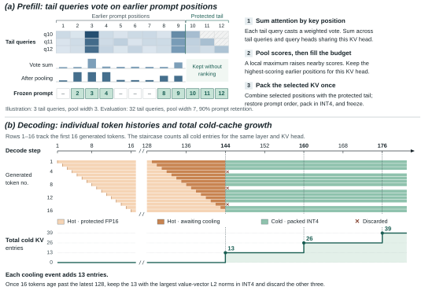

# DuetKV



**English** · [简体中文](README.zh-CN.md)

DuetKV manages Llama’s key–value (KV) cache differently for prompt tokens and generated tokens. During prefill, each KV head uses attention scores from the end of the prompt to select the positions it will keep. DuetKV packs the selected keys and values one layer at a time, releasing each layer’s dense KV to reduce peak memory on long inputs. During decoding, newly generated tokens stay in an FP16 window. As they age out, DuetKV selects and quantizes a batch at a time for cold storage. [Source code](DuetKV-code/)

## Quick start

Run the commands from the repository root. This example generates a greedy response to a single unpadded prompt. You need a CUDA GPU and a local copy of `Llama-3.1-8B-Instruct` with its weights, configuration, and tokenizer. [A800 experiment configuration](#a800-experiment-configuration)

<details>
<summary>Install the dependencies in a fresh Linux environment</summary>

Use Python 3.10, an NVIDIA driver that supports CUDA 12.1, and a CUDA toolkit with `nvcc` and a C++ compiler to build FlashAttention. Activate your Python environment and install the following packages.

```bash
python3 -m pip install 'setuptools<81' wheel packaging ninja psutil
python3 -m pip install 'torch==2.5.1+cu121' --extra-index-url https://download.pytorch.org/whl/cu121
python3 -m pip install 'transformers==4.46.3' 'accelerate==1.1.1' 'numpy==1.26.4'
python3 -m pip install 'flash-attn==2.7.4.post1' --no-build-isolation
```

</details>

Set `MODEL_DIR` to your local model directory. `PYTHONPATH` adds the DuetKV package and the benchmark configuration.

```bash
export MODEL_DIR="/data/Llama-3.1-8B-Instruct/snapshots/master"
core="$PWD/DuetKV-code"
export PYTHONPATH="$core:$core/benchmark"
```

Run the example in the same shell. Edit `messages` to change the prompt.

```bash
python3 - <<'PY'
import os

import torch
from transformers import AutoTokenizer

from common import PROFILE, options
from DuetKV import runtime as rt
from DuetKV.memory_prefill import memory_prefill

model_dir = os.environ['MODEL_DIR']
model, _, _ = rt.load_model(model_dir, 'duetkv')
tokenizer = AutoTokenizer.from_pretrained(model_dir, local_files_only=True)
messages = [{'role': 'user', 'content': 'Explain the KV cache in two sentences.'}]
ids = tokenizer.apply_chat_template(
    messages, add_generation_prompt=True, return_tensors='pt'
).to('cuda')

cfg = options(PROFILE)  # Prompt90 profile used in the A800 experiments
limit = 64
rt.reset_sample(model, 'duetkv', cfg, limit)
eos = model.generation_config.eos_token_id
stop_ids = {eos} if isinstance(eos, int) else set(eos or [])

with torch.inference_mode():
    logits, cache = memory_prefill(model, ids, cfg, rt, {})
    output = []
    for _ in range(limit):
        token = logits[:, -1].argmax(dim=-1, keepdim=True)
        output.append(token.item())
        if output[-1] in stop_ids or len(output) == limit:
            break
        logits, cache, _ = rt.forward(model, token, cache, cache.true_seq_length, 'duetkv')
        cache.finish_decode_step()

print(tokenizer.decode(output, skip_special_tokens=True))
PY
```

Prefill produces the logits for the first output token. For each subsequent token, feed the previous token back at its absolute position, `cache.true_seq_length`. Call `finish_decode_step()` once after each decode forward pass to cool eligible entries and advance the cache position.

## Reproduce A800 decode throughput and peak memory

### A800 experiment configuration

All 16 workload configurations use the `J_p90_w128_o32` profile. The experiment varies three quantities: input length, output length, and batch size. [Profile definition](DuetKV-code/benchmark/common.py) · [Benchmark entry point](DuetKV-code/benchmark/engine.py)

| Setting | Value used in the experiment |
|---|---|
| Hardware and model | One NVIDIA A800-SXM4-80GB (SM80), running Llama-3.1-8B-Instruct in FP16. The model has 32 layers, 32 query heads and 8 KV heads per layer, and a head dimension of 128. |
| Software | Python `3.10.16`, PyTorch `2.5.1+cu121`, Transformers `4.46.3`, FlashAttention `2.7.4.post1`, Triton `3.1.0`. |
| Runtime | Random seed `20261029`. TF32 disabled for matrix multiplication and cuDNN. CPU threads: `OMP_NUM_THREADS=4`, `MKL_NUM_THREADS=4`, `OPENBLAS_NUM_THREADS=1`. |
| Inputs and batching | Take the first `batch` prompts from a fixed bank of eight and truncate each to `8192` or `32768` tokens. Run `1`, `2`, `4`, or `8` requests together in one batched forward pass. |
| Outputs and timing | Greedy decoding with a fixed output of `256` or `2048` tokens per request. Each workload has one warm-up and three measured runs, for 16 warm-ups and 48 measurements in total. |
| Prompt selection | `prefill_keep_ratio=0.90`, `obs_window=32`, `sink_tokens=0`. Candidate scores use `pool_kernel=7` and `pooling='maxpool'`. |
| Prefill | `prefix_chunk_size=512` for the FlashAttention 2 prefix. The final 32 queries use eager attention to select positions. Layer-by-layer packing uses `consume_dense_cache=True`. |
| Generated KV and quantization | `recent_window=128`, `lazy_g=16`, `decode_keep_ratio=0.80` (keep 13 of every 16 entries eligible for cooling). `prompt_bits=4`, `cold_bits=4`, `group_size=32`. The hot window uses FP16. |
| Storage optimizations | `fused_quantize=True`, `reuse_workspace=True`, `paged_cold=True`, `page_slots=32`, `hot_ring=True`. |
| Attention optimizations | `cold_group=8`, `specialized_4bit=True`, `gqa_reuse=True`, `channel_contiguous_k=True`, `a800_prompt_mma=True`. |
| Decode kernel scheduling | `num_splits=None`, `block_n=None`, `num_warps=None` enable automatic planning. `fuse_packed_fma=False`. The table below gives the resulting prompt split counts. |

### Decode parallelism with `num_splits`

`num_splits` controls how many parts of a KV segment the GPU processes in parallel along the token axis. Each part computes a partial attention result, and a second kernel merges the partial results for each query head. Too few splits can leave GPU compute units idle. More splits increase the amount of intermediate data the kernels write and merge. This trade-off affects decode throughput. Two related settings control different dimensions of parallelism: `batch` sets the number of simultaneous requests, and `num_warps` sets the number of warps per thread block. [Segmented decode kernel](DuetKV-code/DuetKV/kernels/segmented_attention.py)

The A800 runs used automatic scheduling. The values below come from the planner with 108 streaming multiprocessors, head dimension 128, `32 × batch` query heads, and 90% prompt retention. Each entry is the number of splits for the **prompt segment of one KV head**. The same counts apply to both output lengths. [Launch planner](DuetKV-code/DuetKV/kernels/launch_config.py) · [Segment layout](DuetKV-code/DuetKV/kernels/segmented_plan.py)

| Input tokens | Positions kept per KV head | Batch 1 | Batch 2 | Batch 4 | Batch 8 |
|---:|---:|---:|---:|---:|---:|
| 8192 | 7373 | 62 | 62 | 32 | 16 |
| 32768 | 29491 | 128 | 64 | 32 | 16 |

For 8192 input tokens at batch 1, the planner assigns up to 120 positions to each split. The 7373 retained positions yield 62 splits per KV head, so eight heads launch 496 thread blocks for the prompt. The hot and cold segments add their own blocks as decoding progresses. The planner selects `block_n=8` and `num_warps=4`. Within each split, the A800 prompt matrix-multiply kernel iterates in tiles of 64 tokens.

To set the split count explicitly, call `DuetKV.kernels.segmented_attention.segmented_duetkv_decode(..., num_splits=32)`. To use that setting in a full model run, pass the same keyword at the decode kernel call in the Llama adapter. Use the default `None` to reproduce the table. [Llama decode call site](DuetKV-code/DuetKV/batched_attention.py)

### Rebuild the results table from the recorded runs

For each workload, take the median aggregate decode throughput and the largest whole-run memory peak across its three measured runs. Memory is reported in GiB of GPU memory allocated by PyTorch, including model weights, KV tensors, and temporary tensors.

Run the following command at the repository root with Python 3. It reads the 48 measurements and prints all 16 rows. For 8192 input tokens, 256 output tokens, and batch 1, it yields **41.68 tokens/s** and **16.17 GiB**. For 32768 input tokens, 2048 output tokens, and batch 8, it yields **78.95 tokens/s** and **53.41 GiB**. [Recorded measurements](DuetKV-code/data/a800_decode.json)

```bash
python3 - <<'PY'
import json
from collections import defaultdict
from pathlib import Path
from statistics import median

runs = defaultdict(list)
path = Path('DuetKV-code/data/a800_decode.json')
for row in json.loads(path.read_text(encoding='utf-8')):
    runs[tuple(row['case'])].append(row)

print('Input  Output  Batch  Decode (tokens/s)   Peak (GiB)')
for (n, t, batch), rows in sorted(runs.items()):
    speed = median(r['aggregate_tokens_per_s'] for r in rows)
    peak = max(r['peak_allocated_bytes'] for r in rows) / 2**30
    print(f'{n:5}  {t:4}  {batch:4}  {speed:18.2f}  {peak:10.2f}')
PY
```

### Run one workload on your GPU

To measure a different configuration or GPU, start with 8192 input tokens, 256 output tokens, and batch 1. Use the model directory and environment from the quick start. The example reads the original input token IDs, calls `memory_prefill()`, and runs the benchmark’s fixed-length decoder. One warm-up covers initial Triton compilation before the timed run.

<details>
<summary>Run the single-workload benchmark</summary>

```bash
OMP_NUM_THREADS=4 MKL_NUM_THREADS=4 OPENBLAS_NUM_THREADS=1 python3 - <<'PY'
import gzip
import json
import os
from pathlib import Path

import torch
from common import PROFILE, ROOT, options
from engine import DuetKVEngine, run

n, t, batch = 8192, 256, 1
with gzip.open(ROOT / 'data/speed.json.gz', 'rt') as f:
    rows = [row[:n] for row in json.load(f)[:batch]]

torch.manual_seed(20261029)
torch.backends.cuda.matmul.allow_tf32 = False
torch.backends.cudnn.allow_tf32 = False
engine = DuetKVEngine(Path(os.environ['MODEL_DIR']), options(PROFILE))
with torch.inference_mode():
    run(engine, rows, t, stops=[], quality=False, progress={})  # Warm up
    engine.release()
    result = run(engine, rows, t, stops=[], quality=False, progress={})
print(f"Aggregate decode throughput: {result['aggregate_tokens_per_s']:.2f} token/s")
print(f"Peak allocated memory: {result['peak_allocated_bytes'] / 2**30:.2f} GiB")
PY
```

`n` is the input length per request, `t` is the fixed output length per request, and `batch` is the number of concurrent requests. Prefill produces the first token, so `t=256` corresponds to 255 decode steps. Throughput counts decoded tokens across the entire batch. Divide it by `batch` for the per-request rate. [Benchmark code](DuetKV-code/benchmark/engine.py)

</details>

## DuetKV parameters

`cfg = options(PROFILE)` loads the Prompt90 configuration used on the A800. For example, to retain 75% of the initial prompt, set `cfg['prefill_keep_ratio'] = 0.75` before calling `rt.reset_sample()`. `PROFILE['id']` identifies the configuration in experiment records. [Profile definition](DuetKV-code/benchmark/common.py)

### Token retention and quantization

| `cfg` parameter | Prompt90 value | Meaning |
|---|---:|---|
| `prefill_keep_ratio` | `0.90` | Fraction of initial prompt positions to keep per layer and KV head, in `(0, 1]`. The budget is `round(input_length × ratio)`, with at least one position retained and priority given to `sink_tokens`. Heads can select different positions. |
| `sink_tokens` | `0` | Number of leading prompt tokens to protect. A nonnegative integer. These positions take priority over the observation window. Set to `0` to disable leading-token protection. |
| `obs_window` | `32` | Number of queries at the end of the prompt that vote on earlier positions. A positive integer. After protecting the leading tokens, DuetKV keeps recent positions within the remaining budget and fills any remaining slots using the votes. |
| `prompt_bits` | `4` | Packed bit width for both prompt keys and values. Supports `2`, `4`, or `8` bits per quantized element. |
| `recent_window` | `128` | Number of recently generated tokens to retain in FP16. A larger window preserves more recent KV at full precision and uses more hot-cache memory. Must be positive. |
| `lazy_g` | `16` | Number of older generated tokens to collect before cooling a batch. Must be positive. The hot cache normally has capacity for `recent_window + lazy_g` entries. |
| `decode_keep_ratio` | `0.80` | Fraction of each cooling batch to retain, in `(0, 1]`. Each KV head ranks positions by the L2 norm of the value vector and keeps `max(1, round(batch_length × ratio))`. Set to `1` to move the whole batch into cold storage. |
| `cold_bits` | `4` | Packed bit width for cold keys and values. Supports `2`, `4`, or `8` bits and can be set independently of `prompt_bits`. |
| `group_size` | `32` | Number of elements that share a quantization scale and minimum. Keys are grouped along the token axis and values along the head dimension. Smaller groups give finer quantization and store more scale and minimum values. Must be positive. |

With 8192 input tokens and `prefill_keep_ratio=0.9`, each KV head retains 7373 prompt positions. The first cooling batch forms when the hot cache reaches 144 generated entries. DuetKV keeps 13 of the oldest 16, quantizes them into cold storage, and leaves the most recent 128 in FP16.

### Storage and decode optimizations

These settings live in `cfg['optimizations']`. For example, `cfg['optimizations']['hot_ring'] = False` disables the hot ring buffer. When constructed directly, `OptimizationConfig()` starts with all Boolean switches off, `page_slots=32`, and `cold_group=1`. The table lists the values used on the A800. [Optimization definitions](DuetKV-code/DuetKV/optimizations.py)

| Parameter | A800 value | Meaning |
|---|---:|---|
| `fused_quantize` | `True` | Fuse quantization and packing for supported CUDA tensor shapes and INT4 layouts. Other shapes and layouts use the general packing implementation. |
| `reuse_workspace` | `True` | Reuse segment descriptors and scratch buffers across decode steps to reduce allocation and rebuilding. |
| `paged_cold` | `True` | Allocate cold storage in pages so multiple cold segments can share a page. |
| `page_slots` | `32` | Number of cold-segment slots per page when paging is enabled. Larger pages reserve more space per allocation. Must be positive. |
| `cold_group` | `8` | Number of cold segments scheduled together for decode attention. Accepts `1`, `4`, `8`, or `16`. Leftover segments are processed individually. |
| `specialized_4bit` | `True` | Use a specialized INT4 attention kernel when descriptor bit widths, grouping, and layout are compatible. |
| `gqa_reuse` | `True` | In grouped-query attention, reuse K/V reads across query heads that share a KV head. |
| `hot_ring` | `True` | Store hot KV in a ring buffer. After cooling, advance the start index to avoid copying the remaining hot entries. |
| `channel_contiguous_k` | `True` | Lay out INT4 keys with contiguous channels so the kernel can read adjacent channels at a position. Values remain grouped along the head dimension. |
| `a800_prompt_mma` | `True` | Use SM80 Tensor Cores for prompt attention. Requires compatible INT4 segments, channel-contiguous keys, GQA reuse, four query heads per KV head, and a head dimension of 128. |

### Low-level parameters

| Interface | Parameter | Meaning |
|---|---|---|
| `memory_prefill()` | `prefix_chunk_size` | Number of prefix tokens processed per call before the observation window. Fixed-length speed runs use the default `512`. With `None`, the whole prefix runs in one call, as in the original batch-1 quality evaluation. |
| `select_prompt_indices()` | `pool_kernel`, `pooling` | Apply 1-D pooling to candidate vote scores. `pool_kernel` controls the width. `None` or `1` skips pooling. `pooling` accepts `maxpool` or `avgpool`. `memory_prefill()` uses `7` and `maxpool`. |
| `DuetKVCache.from_dense_prefill()` | `prompt_len`, `keep_indices` | `prompt_len` is the original input length. `keep_indices` contains one integer tensor per layer with shape `[batch, kv_heads, positions_kept]`. Positions are unique within a head, and all layers retain the same count. Omit the indices to keep every position. |
| `DuetKVCache.from_dense_prefill()` | `consume_dense_cache` | Defaults to `False`. `memory_prefill()` takes exclusive ownership of the dense cache and sets this to `True`, clearing each layer’s source K/V references as soon as its packed representation is ready. |
| `segmented_duetkv_decode()` | `num_splits`, `block_n`, `num_warps` | Override the parallel split count (positive integer), tokens per thread block (power of two), and warps per block (`1/2/4/8/16/32`). Each defaults to `None` for automatic selection based on tensor shape and GPU. |
| `segmented_duetkv_decode()` | `fuse_packed_fma` | Diagnostic switch, default `False`. Allows the compiler to fuse floating-point multiply-adds in the first kernel of the optimized decode path. |

When called directly, `from_dense_prefill()` defaults to `prompt_bits=2`, `recent_window=32`, and `decode_keep_ratio=1.0`. Prompt90 sets these to `4`, `128`, and `0.8`, respectively. [Cache constructor](DuetKV-code/DuetKV/duetkv_cache.py) · [Segmented decode interface](DuetKV-code/DuetKV/kernels/segmented_attention.py)

## Other A800 measurements

The Prompt90 quality evaluation covered 320 LongBench, 64 RULER, and 48 LongGenBench examples. It used the version before the prefill memory optimization. The LongGenBench results came from the parameter-selection run with the same settings. A separate same-GPU spot check measured time to first token (TTFT) before and after the optimization: 1.0251 → 1.0199 s at 8192 input tokens and batch 1, and 48.4278 → 48.2224 s at 32768 input tokens and batch 8. Both workloads generated 256 tokens per request.
