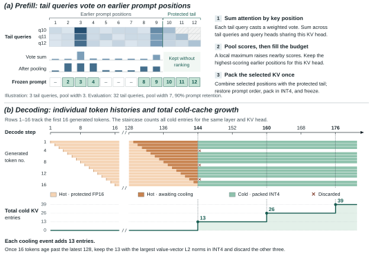

# DuetKV



[English](README.md) · **简体中文**

DuetKV 按 token 的来源和生成时间管理 Llama 的 KV 缓存。预填充时，每个 KV 头根据注意力分数选择输入位置，量化后存入 Prompt 区。解码时，新生成的 token 先保存在 FP16 热区，超出窗口后再分批筛选、量化，移入冷区。预填充过程中，DuetKV 逐层打包并释放旧 KV，降低长输入时的峰值显存。当前源码位于 [DuetKV-code](DuetKV-code/)。

## 快速调用 DuetKV

以下命令均从仓库根目录开始。示例使用单条无填充输入和贪心解码。准备一张 CUDA 显卡，以及包含权重、配置和分词器的本地 `Llama-3.1-8B-Instruct` 模型目录。软件版本见下文的[正式实验配置](#a800-正式实验配置)。

<details>
<summary>在新的 Linux 环境中安装单模型示例所需的依赖</summary>

先准备 Python 3.10、支持 CUDA 12.1 的 NVIDIA 驱动，以及编译 FlashAttention 所需的 CUDA 工具链（含 `nvcc`）和 C++ 编译器。激活 Python 虚拟环境后，安装以下依赖。

```bash
python3 -m pip install 'setuptools<81' wheel packaging ninja psutil
python3 -m pip install 'torch==2.5.1+cu121' --extra-index-url https://download.pytorch.org/whl/cu121
python3 -m pip install 'transformers==4.46.3' 'accelerate==1.1.1' 'numpy==1.26.4'
python3 -m pip install 'flash-attn==2.7.4.post1' --no-build-isolation
```

</details>

将 `MODEL_DIR` 改成本机模型目录。`PYTHONPATH` 包含 DuetKV 源码和实验配置目录。

```bash
export MODEL_DIR="/data/Llama-3.1-8B-Instruct/snapshots/master"
core="$PWD/DuetKV-code"
export PYTHONPATH="$core:$core/benchmark"
```

在同一终端运行以下示例。替换 `messages` 中的问题即可更换输入。

```bash
python3 - <<'PY'
import os

import torch
from transformers import AutoTokenizer

from common import PROFILE, options
from DuetKV import runtime as rt
from DuetKV.memory_prefill import memory_prefill

model_dir = os.environ['MODEL_DIR']
model, _, _ = rt.load_model(model_dir, 'duetkv')
tokenizer = AutoTokenizer.from_pretrained(model_dir, local_files_only=True)
messages = [{'role': 'user', 'content': '请用两句话解释什么是 KV 缓存。'}]
ids = tokenizer.apply_chat_template(
    messages, add_generation_prompt=True, return_tensors='pt'
).to('cuda')

cfg = options(PROFILE)  # A800 实验使用的 Prompt90 配置
limit = 64
rt.reset_sample(model, 'duetkv', cfg, limit)
eos = model.generation_config.eos_token_id
stop_ids = {eos} if isinstance(eos, int) else set(eos or [])

with torch.inference_mode():
    logits, cache = memory_prefill(model, ids, cfg, rt, {})
    output = []
    for _ in range(limit):
        token = logits[:, -1].argmax(dim=-1, keepdim=True)
        output.append(token.item())
        if output[-1] in stop_ids or len(output) == limit:
            break
        logits, cache, _ = rt.forward(model, token, cache, cache.true_seq_length, 'duetkv')
        cache.finish_decode_step()

print(tokenizer.decode(output, skip_special_tokens=True))
PY
```

预填充产生第一个输出 token。之后每次把刚生成的 token 送回模型，用 `cache.true_seq_length` 指定它在原序列中的绝对位置。每次解码前向结束后调用一次 `finish_decode_step()`，完成冷却并推进位置。

## 快速复现 A800 的解码吞吐和峰值显存

### A800 正式实验配置

16 个测点使用同一份 `J_p90_w128_o32` 配置，只改变输入长度、输出长度和批量大小。下表列出运行条件及生效参数。[配置定义](DuetKV-code/benchmark/common.py) · [运行入口](DuetKV-code/benchmark/engine.py)

| 项目 | 本次取值 |
|---|---|
| 硬件与模型 | 单张 NVIDIA A800-SXM4-80GB（SM80），Llama-3.1-8B-Instruct，FP16。模型有 32 层，每层 32 个查询头、8 个 KV 头，每头 128 维。 |
| 软件 | Python `3.10.16`，PyTorch `2.5.1+cu121`，Transformers `4.46.3`，FlashAttention `2.7.4.post1`，Triton `3.1.0`。 |
| 运行环境 | 随机种子 `20261029`，矩阵乘法和 cuDNN 均关闭 TF32。CPU 线程设置为 `OMP_NUM_THREADS=4`、`MKL_NUM_THREADS=4`、`OPENBLAS_NUM_THREADS=1`。 |
| 输入与并发 | 从固定的 8 条输入中取前 `batch` 条，每条截取前 `8192` 或 `32768` 个 token。`batch` 取 `1 / 2 / 4 / 8`，同一批请求一起前向计算。 |
| 输出与计时 | 贪心解码，固定输出 `256` 或 `2048` 个 token。每个测点预热 1 轮、正式测量 3 轮，共 16 轮预热、48 轮正式测量。 |
| Prompt 选择 | `prefill_keep_ratio=0.90`，`obs_window=32`，`sink_tokens=0`。候选位置用 `pool_kernel=7`、`pooling='maxpool'` 评分。 |
| 预填充 | `prefix_chunk_size=512`，前缀用 FlashAttention 2 分块计算，末尾 32 个查询用 eager 注意力选位置。逐层打包时 `consume_dense_cache=True`。 |
| 生成缓存与量化 | `recent_window=128`，`lazy_g=16`，`decode_keep_ratio=0.80`（每 16 个保留 13 个）。`prompt_bits=4`，`cold_bits=4`，`group_size=32`，热区为 FP16。 |
| 存储优化 | `fused_quantize=True`，`reuse_workspace=True`，`paged_cold=True`，`page_slots=32`，`hot_ring=True`。 |
| 注意力优化 | `cold_group=8`，`specialized_4bit=True`，`gqa_reuse=True`，`channel_contiguous_k=True`，`a800_prompt_mma=True`。 |
| 解码内核调度 | `num_splits=None`，`block_n=None`，`num_warps=None`，由规划器选值。`fuse_packed_fma=False`。各批量下的 Prompt 分段数见下表。 |

### 用 `num_splits` 控制解码并行度

`num_splits` 控制一个 KV 段沿 token 轴拆成多少份并行计算。每份独立计算局部注意力，再由归并内核合成每个查询头的输出。分段太少时，GPU 上同时工作的计算块可能太少。分段增多时，要写回和归并的中间结果也会增加。这一取舍直接影响解码吞吐。`batch` 控制一次处理多少条请求，`num_warps` 控制每个计算块使用多少个 warp。[分段解码内核](DuetKV-code/DuetKV/kernels/segmented_attention.py)

正式入口使用自动分段。下表按 A800 的 108 个 SM、头维 128、`32 × batch` 个查询头和 90% Prompt 保留率，用项目的规划器复算。表中每个数字表示**每个 KV 头的 Prompt 段**拆成几份，输出长度 256 和 2048 共用此表。[分段规划器](DuetKV-code/DuetKV/kernels/launch_config.py) · [缓存分段布局](DuetKV-code/DuetKV/kernels/segmented_plan.py)

| 输入 token 数 | 每个 KV 头保留的位置 | 批量 1 | 批量 2 | 批量 4 | 批量 8 |
|---:|---:|---:|---:|---:|---:|
| 8192 | 7373 | 62 | 62 | 32 | 16 |
| 32768 | 29491 | 128 | 64 | 32 | 16 |

以 8192 输入、批量 1 为例，规划器按每段最多 120 个位置切分，7373 个位置得到 62 段。8 个 KV 头合计有 496 个计算块负责 Prompt。生成过程中，冷区和热区的计算块另计。本次规划得到 `block_n=8`、`num_warps=4`。A800 的 Prompt 专用矩阵乘法内核在每个分段内按 64 个 token 迭代。

直接调用 `DuetKV.kernels.segmented_attention.segmented_duetkv_decode(..., num_splits=32)` 可以指定 32 个分段。要在完整推理中使用这个值，把同一参数传给 Llama 适配器中的解码内核。复现上表时使用默认值 `None`。[Llama 解码调用位置](DuetKV-code/DuetKV/batched_attention.py)

### 从逐轮记录复算 16 个测点

总解码吞吐取 3 轮正式测量的中位数，整轮峰值显存取 3 轮最大值。峰值按 PyTorch 实际分配的显存统计，包含模型权重、KV 和临时张量。

在仓库根目录运行下面的命令，只需 Python 3。它从 48 份逐轮记录生成完整的 16 行结果表。举例来说，8192 输入、256 输出、批量 1 的解码吞吐为 **41.68 token/s**，峰值为 **16.17 GiB**。32768 输入、2048 输出、批量 8 的对应结果为 **78.95 token/s** 和 **53.41 GiB**。[逐轮测量数据](DuetKV-code/data/a800_decode.json)

```bash
python3 - <<'PY'
import json
from collections import defaultdict
from pathlib import Path
from statistics import median

runs = defaultdict(list)
path = Path('DuetKV-code/data/a800_decode.json')
for row in json.loads(path.read_text(encoding='utf-8')):
    runs[tuple(row['case'])].append(row)

print('输入   输出   批量   总解码吞吐(token/s)   峰值(GiB)')
for (n, t, batch), rows in sorted(runs.items()):
    speed = median(r['aggregate_tokens_per_s'] for r in rows)
    peak = max(r['peak_allocated_bytes'] for r in rows) / 2**30
    print(f'{n:5}  {t:4}  {batch:4}  {speed:18.2f}  {peak:10.2f}')
PY
```

### 在自己的 GPU 上运行一个测点

更换参数或硬件后，可以从 `8192 + 256，批量 1` 开始。沿用快速调用中的模型路径和环境，下面的示例读取实验保存的输入 token，调用 `memory_prefill()` 进行预填充，再使用基准程序执行固定长度解码。先预热一次，让 Triton 完成首次编译，再打印一次实测结果。

<details>
<summary>展开单个测点的运行代码</summary>

```bash
OMP_NUM_THREADS=4 MKL_NUM_THREADS=4 OPENBLAS_NUM_THREADS=1 python3 - <<'PY'
import gzip
import json
import os
from pathlib import Path

import torch
from common import PROFILE, ROOT, options
from engine import DuetKVEngine, run

n, t, batch = 8192, 256, 1
with gzip.open(ROOT / 'data/speed.json.gz', 'rt') as f:
    rows = [row[:n] for row in json.load(f)[:batch]]

torch.manual_seed(20261029)
torch.backends.cuda.matmul.allow_tf32 = False
torch.backends.cudnn.allow_tf32 = False
engine = DuetKVEngine(Path(os.environ['MODEL_DIR']), options(PROFILE))
with torch.inference_mode():
    run(engine, rows, t, stops=[], quality=False, progress={})  # 预热
    engine.release()
    result = run(engine, rows, t, stops=[], quality=False, progress={})
print(f"总解码吞吐 {result['aggregate_tokens_per_s']:.2f} token/s")
print(f"整轮峰值显存 {result['peak_allocated_bytes'] / 2**30:.2f} GiB")
PY
```

`n` 是每条请求的输入 token 数，`t` 是固定输出 token 数，`batch` 是同时处理的请求数。首个输出 token 来自预填充，因此 `t=256` 对应 255 个解码步。总解码吞吐统计整个批次，除以 `batch` 即为单条请求的解码速度。[测量代码](DuetKV-code/benchmark/engine.py)

</details>

## DuetKV 参数说明

`cfg = options(PROFILE)` 载入 A800 实验使用的 Prompt90 配置。要将首次输入的保留率改为 75%，在调用 `rt.reset_sample()` 之前设置 `cfg['prefill_keep_ratio'] = 0.75`。`PROFILE['id']` 只标识实验配置。[配置来源](DuetKV-code/benchmark/common.py)

### 保留哪些 token，怎样量化

| `cfg` 参数 | Prompt90 实验值 | 取值与作用 |
|---|---:|---|
| `prefill_keep_ratio` | `0.90` | 首次输入中每层、每个 KV 头保留的位置比例，范围 `(0, 1]`。预算按 `round(输入长度 × 比例)` 计算，至少保留 1 个位置，并优先满足 `sink_tokens`。各头可以选择不同位置。 |
| `sink_tokens` | `0` | 强制保留的开头 token 数，取非负整数。`0` 取消开头保护。开头位置优先于观察窗口占用预算。 |
| `obs_window` | `32` | 输入末尾参与注意力投票的查询数，取正整数。算法先在剩余预算内保留最近的位置，再用投票分数选择中间位置。 |
| `prompt_bits` | `4` | Prompt 区 K 和 V 的打包位宽，可取 `2`、`4`、`8`。位宽越低，每个量化值占用的位数越少。 |
| `recent_window` | `128` | 用 FP16 保护的最近生成 token 数，取正整数。增大窗口会让更多近期 KV 保持原精度，也会增加热区占用。 |
| `lazy_g` | `16` | 一次冷却积累的 token 数，取正整数。超出 `recent_window` 的 token 积满一批时触发冷却，热区常规容量为 `recent_window + lazy_g`。 |
| `decode_keep_ratio` | `0.80` | 每批待冷却位置的保留比例，范围 `(0, 1]`。每个 KV 头按 V 向量的 L2 范数选择位置，保留 `max(1, round(批长 × 比例))` 个。设为 `1` 时整批进入冷区。 |
| `cold_bits` | `4` | 冷区 K 和 V 的打包位宽，可取 `2`、`4`、`8`，可与 `prompt_bits` 分别设置。 |
| `group_size` | `32` | 共享一组量化比例和最小值的元素数，取正整数。K 沿 token 轴分组，V 沿头维度分组。组越小，量化参数越细，存储的比例和最小值也越多。 |

例如，8192 个输入 token 在 `prefill_keep_ratio=0.9` 时，每个 KV 头保留 7373 个位置。解码时，热区积累到 144 个 token 就会触发第一次冷却。此时从最旧的 16 个中保留 13 个，量化后移入冷区，最近的 128 个继续以 FP16 保存。

### 存储与解码优化

下表的参数位于 `cfg['optimizations']`。例如 `cfg['optimizations']['hot_ring'] = False` 会关闭热区环形缓冲。直接创建底层 `OptimizationConfig()` 时，各布尔开关默认关闭，`page_slots=32`、`cold_group=1`。A800 的实际取值见下表。[优化开关定义](DuetKV-code/DuetKV/optimizations.py)

| 参数 | A800 实验值 | 作用 |
|---|---:|---|
| `fused_quantize` | `True` | 对支持的 CUDA 张量形状和 INT4 布局融合量化与打包，其余情况使用通用打包实现。 |
| `reuse_workspace` | `True` | 解码时复用分段描述表和中间结果缓冲区，减少重复分配和重建。 |
| `paged_cold` | `True` | 按页为冷段分配存储，让多个冷段共用一页。 |
| `page_slots` | `32` | 每页可容纳的冷段槽位数，取正整数，在启用冷区分页时生效。页越大，单页预留的空间越多。 |
| `cold_group` | `8` | 解码注意力调度时每组合并处理的冷段数，可取 `1`、`4`、`8`、`16`。冷段不足一组时逐段处理。 |
| `specialized_4bit` | `True` | 描述表中的位宽、分组和布局兼容时，启用专用 INT4 注意力内核。 |
| `gqa_reuse` | `True` | 在分组查询注意力（GQA）中，让共享同一个 KV 头的多个查询头复用同一批 K/V 读取。 |
| `hot_ring` | `True` | 将热区作为环形缓冲区，冷却后移动起始下标，省去搬移剩余热 KV 的开销。 |
| `channel_contiguous_k` | `True` | 将 INT4 K 按通道连续的方式存储，便于内核连续读取同一位置的多个通道。V 仍沿头维度分组。 |
| `a800_prompt_mma` | `True` | 在 SM80 上使用 Tensor Core 加速 Prompt 段注意力。需要兼容的 INT4 分段、通道连续 K、GQA 复用、每个 KV 头对应 4 个查询头，且头维为 128。 |

### 直接调用底层接口时的参数

| 接口 | 参数 | 含义 |
|---|---|---|
| `memory_prefill()` | `prefix_chunk_size` | 观察窗口之前的前缀每次处理多少个 token。默认 `512`，用于固定长度测速。`None` 表示一次处理整个前缀，原 B1 质量评估采用此设置。 |
| `select_prompt_indices()` | `pool_kernel`、`pooling` | 对候选位置的投票分数做一维池化。`pool_kernel` 控制窗口宽度，`None` 或 `1` 跳过池化。`pooling` 可选 `maxpool`（取最大值）或 `avgpool`（取平均值）。`memory_prefill()` 固定传入 `7` 和 `maxpool`。 |
| `DuetKVCache.from_dense_prefill()` | `prompt_len`、`keep_indices` | `prompt_len` 是原始输入长度。`keep_indices` 是逐层的整数位置张量，形状为 `[批量, KV 头数, 保留数]`，同一头内位置唯一，各层保留数一致。省略下标会保留全部位置。 |
| `DuetKVCache.from_dense_prefill()` | `consume_dense_cache` | 默认 `False`。`memory_prefill()` 显式设为 `True`，每打包完一层就清空源缓存列表中该层的 K/V 引用。调用方需将源缓存交给该接口独占。 |
| `segmented_duetkv_decode()` | `num_splits`、`block_n`、`num_warps` | 手动指定分段并行数（正整数）、每个计算块的 token 数（2 的幂）和每块 warp 数（`1/2/4/8/16/32`）。三者默认 `None`，由内核根据输入形状和 GPU 选择。 |
| `segmented_duetkv_decode()` | `fuse_packed_fma` | 诊断开关，默认 `False`。在优化解码路径中允许编译器对第一个内核的浮点乘加做融合。 |

直接调用 `from_dense_prefill()` 时，默认采用 `prompt_bits=2`、`recent_window=32` 和 `decode_keep_ratio=1.0`。Prompt90 将这三项分别设为 `4`、`128` 和 `0.8`。[缓存构造接口](DuetKV-code/DuetKV/duetkv_cache.py) · [分段解码接口](DuetKV-code/DuetKV/kernels/segmented_attention.py)

## 其他 A800 测量

Prompt90 质量评估使用预填充显存优化前的版本，覆盖 320 条 LongBench、64 条 RULER 和 48 条 LongGenBench 样本。LongGenBench 沿用相同参数下的选参结果。另在同一张 GPU 上做了两组首 token 延迟（TTFT）快速复测，各生成 256 个 token。优化前后，8192 输入、批量 1 的中位延迟为 1.0251 → 1.0199 秒，32768 输入、批量 8 为 48.4278 → 48.2224 秒。
